<div align="center">

<picture>
  <source media="(prefers-color-scheme: dark)" srcset="docs/readme/logo-escuro.png">
  
</picture>

# JOTV

**Filmes, séries e TV ao vivo no celular, na televisão e no computador.**

Um app só para celular, tablet, Android TV, LG webOS, Samsung Tizen, Roku, Windows e Linux.<br>
O catálogo vem do TMDB, em português. Os vídeos vêm dos addons e dos plugins que você escolhe.

[](../../releases/latest)
[](../../releases/latest)
[](../../releases/latest)
[](../../releases/latest)
[](https://github.com/LucasR0cha/JOTV-Android/releases/tag/linux-v0.2.2)
[](https://github.com/LucasR0cha/JOTV-Android/releases/tag/roku-v1.0.4)

[Novidades](#novidades) · [Na TV](#na-tv) · [No celular](#no-celular) · [No Windows](#no-windows) · [No Linux](#no-linux) · [No Roku](#no-roku) · [Tudo o que o app faz](#tudo-o-que-o-app-faz) · [Instalação](#instalação) · [Para desenvolvedores](#para-desenvolvedores)

</div>

<p align="center">
  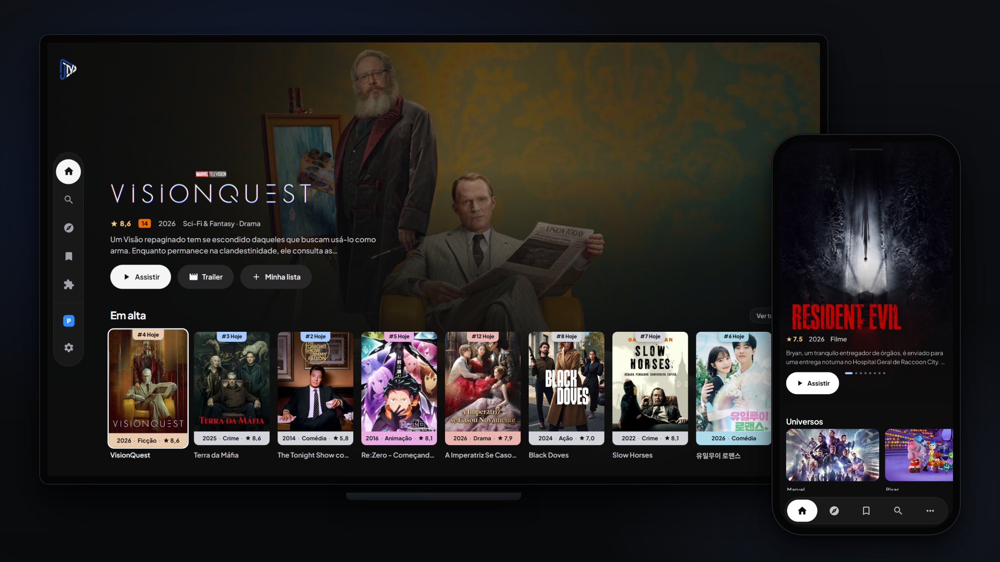
</p>

## O que é o JOTV

O JOTV junta num lugar só tudo o que você assiste. Capas, sinopses, elenco, trailers e notas vêm do
**TMDB**, sempre em português. Os vídeos vêm dos **addons no padrão Stremio** e dos **plugins** que você instala, e o
app escolhe sozinho a melhor fonte para o seu gosto (dublado ou legendado, até a qualidade que você
definir). Na TV tudo funciona pelo controle remoto, no celular pelo toque, e cada pessoa da casa tem o
próprio perfil com lista, histórico e progresso.

O JOTV não hospeda nem distribui vídeo nenhum. Leia o [aviso legal](#aviso-legal).

## Novidades

### Pôster personalizado

Em **Configurações** o **Pôster personalizado** aceita o link de um serviço como o PostersPlus, com os marcadores `{tmdb_id}`, `{imdb_id}`, `{id}`, `{type}` e
`{shape}`, e o botão **Usar o PostersPlus público** liga o servidor público dele, que responde sem chave. O modelo vale por perfil e só entra na hora de desenhar
a capa, nunca é salvo no item, na Minha Lista, no histórico, no backup nem na sincronia. Com a arte pronta o cartão não põe a faixa, a etiqueta nem o selo de
qualidade por cima, e a forma do cartão (retrato, paisagem ou quadrado) segue o que o addon informa. Se a imagem do modelo falhar, volta a arte própria. O
Continuar assistindo, o destaque e o detalhe não usam o modelo, de propósito. As coleções como as do BingeCat mostram a capa dinâmica que o servidor desenha, com o
GIF animando só no foco da Android TV e a pasta com fundo e logo. Vale no Android, na LG, na Samsung, no Windows, no Linux e no Roku (a partir do Roku OS 9.4).

### Fileiras que carregam todas as páginas

A fileira de um catálogo de addon ou de uma coleção parava nos primeiros itens quando o addon mandava 20 ou 30 por página, porque o app esperava 40 para pedir a
próxima. Agora ele segue pedindo página enquanto vierem títulos novos, para ao receber uma página repetida ou três vazias seguidas e não encerra por falha de rede.

### Melhorar imagem no Android

O player do celular e o da Android TV ganham o **Melhorar imagem**, com os ajustes Desligado, Anime e Filme (nitidez no estilo do CAS da AMD, contraste, cores e
brilho em uma passada por quadro) e o **Upscaler SGSR**, que amplia vídeo de baixa resolução em até 3 vezes. Fica desligado por padrão, só custa desempenho quando
está ligado e, se o aparelho perder quadros, o app desliga primeiro só o Upscaler e depois o efeito todo. Cada perfil guarda a própria escolha.

### Player do celular, teclas do controle e computador

No celular os controles do player ficam no centro, com voltar e avançar 10 segundos, play e, nas séries, o episódio anterior e o próximo. Play, Pause e Parar do
controle agora valem nos players de filme e de TV ao vivo da LG, da Samsung e da Android TV, inclusive com a barra de opções ou a lista de canais abertas. No
computador, o Windows e o Linux ficam pensados para o mouse (dica com o nome e o atalho, fundo ao passar, volume e barra de progresso com tempo) e o Ao Vivo deixa
de piscar, com uma grade larga e rolagem infinita. O Melhorar imagem agora também aparece no player ao vivo do computador.

### Windows 0.2.17, Linux 0.2.2 e Roku 1.0.4

O Windows 0.2.17 e o Linux 0.2.2 levam a interface nova, com tudo o que está acima. O Roku 1.0.4 ganha o pôster personalizado.

[Baixar a v1.0.24](https://github.com/LucasR0cha/JOTV-Android/releases/tag/v1.0.24) (Android, LG, Samsung e Windows), [baixar o Linux 0.2.2](https://github.com/LucasR0cha/JOTV-Android/releases/tag/linux-v0.2.2) e [baixar o Roku 1.0.4](https://github.com/LucasR0cha/JOTV-Android/releases/tag/roku-v1.0.4).

### Perfis independentes

Cada perfil agora tem os próprios **addons, plugins, catálogo e Início, TV ao vivo e debrid**, além da lista, do histórico e do progresso que já eram dele.
Ao criar um perfil dá para começar do zero ou **copiar de outro perfil** (você marca o que leva, e o debrid vem de fora porque leva as chaves), e em
Editar perfil o **Fontes e catálogo** mostra de quem é cada categoria, com Copiar de outro perfil (substituir ou somar) e **Usar o mesmo**, um vínculo vivo
que dá para desfazer. Remover um perfil que outros usam deixa uma cópia para eles, e quem já usava o app recebe a cópia do que era do aparelho na
primeira abertura.

A importação da Nuvio pergunta de qual perfil da Nuvio e para qual perfil do aparelho, e ganhou **Todos os perfis**, em que cada perfil da Nuvio vira um
perfil do JOTV com os próprios addons e plugins (os repositórios de plugins agora vêm junto, com os provedores desligados). O Stremio entra no perfil
escolhido. As sessões da Nuvio e do Stremio ficam do aparelho, não do perfil. Vale no celular, na Android TV, na LG, na Samsung, no Windows, no Linux e no Roku.

### Fontes em seções por addon

Com mais de um addon, a lista de fontes abre uma seção por addon, na ordem de Gerenciar addons como no Nuvio, e a barra de filtros ganhou duas fileiras,
**Mostrar** (idioma e qualidade) e **Addon**, com um resumo do que sobrou. O filtro passou a valer por versão, então escolher um addon abre a fonte dele,
com o idioma e a qualidade dela, e o português é reconhecido por apelido. Vale no detalhe, nos episódios e no player. O Roku ganhou a barra e os títulos de
grupo no painel do player.

### Mais melhorias da v1.0.23

O botão **Continuar** da série não exige mais fonte salva, então o progresso que chega da Nuvio, do Stremio ou do Trakt continua do ponto certo. O trailer
do destaque começa mais cedo, o controle da Samsung responde às teclas de mídia, o player do celular abre deitado, o som de outra fonte não aplica mais a
fonte errada e o Ao Vivo lê a programação que alguns addons mandam na descrição do canal. O backup agora leva addons, fontes ao vivo, catálogo e plugins do
perfil, e o backup sem segredos tira usuário e senha dos endereços das listas M3U.

### Windows 0.2.16, Linux 0.2.1 e Roku 1.0.3

O Windows 0.2.16 leva a interface nova, com tudo o que está acima. O Linux 0.2.1 corrige a janela preta que aparecia com o aviso
`Could not create default EGL display` em alguns Linux. O app confere o EGL antes de abrir e, se ele falhar, troca para a renderização por software.
O Roku 1.0.3 ganha os perfis independentes e a barra de filtros nas fontes.

[Baixar a v1.0.23](https://github.com/LucasR0cha/JOTV-Android/releases/tag/v1.0.23) (Android, LG, Samsung e Windows), [baixar o Linux 0.2.1](https://github.com/LucasR0cha/JOTV-Android/releases/tag/linux-v0.2.1) e [baixar o Roku 1.0.3](https://github.com/LucasR0cha/JOTV-Android/releases/tag/roku-v1.0.3).

### Linux 0.2.0 com instalador completo

O Linux recebe as melhorias do Windows 0.2.15 e instaladores completos para **Intel e AMD de 64 bits** e **ARM64 ou AArch64**.
O player, os codecs, o WebKitGTK e as bibliotecas já vêm no pacote. A instalação vale para a conta atual, cria um atalho no menu
e dispensa senha de administrador, FUSE e instalação manual de dependências do aplicativo.

Foram corrigidas a inicialização do mpv com o idioma do sistema, a composição dos controles sobre o vídeo e a biblioteca GLES
ausente no modo de software. HTTP e torrent/P2P passam com vídeo real de teste, e o player passa em 16 verificações na VM EndeavourOS.
Usenet passa na resolução TorBox com respostas controladas, sem download em conta paga. O painel Melhorar imagem acompanha o atual do Windows,
com Upscaler, Filtros e Desempenho. O Linux usa OpenGL e respeita a capacidade do backend.

[Baixar o Linux 0.2.0 e ver o passo a passo](https://github.com/LucasR0cha/JOTV-Android/releases/tag/linux-v0.2.0).
Quem usa AppImage deve executar o novo instalador uma vez. Perfis e configurações são preservados.

### Melhorar imagem completo no Windows

O botão Melhorar imagem do player agora abre um painel com três abas, Upscaler, Filtros e Desempenho. No Upscaler o **Auto** escolhe pela
placa de vídeo, pelo vídeo e pela tela, e há os modelos **A, B, C, A+A, B+B e C+A** do Anime4K, os níveis Anime rápido e Anime qualidade,
opções para filme e série e Retrô e pixel art. No modo Avançado você monta a cadeia com 29 etapas, sobe, desce e troca o tamanho da rede
de cada uma. A aba Filtros mexe em cor, debanding, movimento suave e HDR sem precisar ampliar, e a aba Desempenho mostra quanto cada etapa
gasta por quadro. Continua **desligado por padrão** e guardado por perfil, o botão **Comparar** mostra o vídeo sem a melhoria enquanto está
apertado, e um vigia baixa a qualidade sozinho se a máquina perder quadros. O custo foi medido numa Intel UHD, e nas outras placas é
estimado. São 67 shaders com licença MIT, BSD ou LGPL, sem alteração, e o texto das licenças acompanha o instalador.

[Baixar o Windows 0.2.15](https://github.com/LucasR0cha/JOTV-Android/releases/tag/windows-v0.2.15). [O Linux 0.2.0](https://github.com/LucasR0cha/JOTV-Android/releases/tag/linux-v0.2.0) também recebe o painel completo, usando OpenGL.

### WeTrakr em todos os aparelhos

O WeTrakr conecta por código de dispositivo, sem digitar senha no controle. O que você começa, pausa e termina de assistir vai
para o serviço, e a Minha Lista, o que ficou pela metade e os episódios vistos voltam para o JOTV. A sincronia pergunta primeiro
o que mudou e o player avisa uma vez por evento, para gastar pouco da cota. O JOTV usa a chave de desenvolvimento do WeTrakr,
com cota diária dividida entre todos os usuários do app, e pausa as chamadas por 30 minutos quando ela acaba. Vale no celular,
na Android TV, na LG, na Samsung, no Windows, no Linux e no Roku.

### Minha Lista com 250 títulos e selo Assistido

O histórico passou de 30 para 250 títulos. Filme que você terminou (90 por cento ou mais) sai do Continuar assistindo e fica nos
salvos com o selo **Assistido**, e a série marca só o episódio. O Continuar assistindo só avança para o próximo episódio quando ele
já foi lançado, e a série volta sozinha quando sai episódio ou temporada nova. Também foi corrigida a série que aparecia duas vezes
no Continuar assistindo da LG, da Samsung, do Windows e do Linux, e segurar OK passou a remover também com controle que não repete a tecla.

### Aviso de próximo episódio que não pula o fim

No último minuto o aviso fica manual, sem contagem, e o **Cancelar** pega o foco do controle. A contagem de 10 segundos só começa
depois do fim real do vídeo. Antes o aviso podia avançar sozinho no meio dos créditos.

### Legenda forçada automática e filtros das fontes

A opção **Legenda forçada automática**, ligada por padrão, coloca sozinha a faixa forçada (só as falas em outro idioma) quando a
legenda completa não liga. O painel de fontes do player ganhou uma barra com a contagem e os filtros por qualidade e por addon. No
celular Android, a lista de fontes de um episódio agora rola por arraste. A aba Ao vivo filtra por fonte, como o Descobrir.

### Busca da Android TV pelo teclado do Google

Na busca da Android TV, OK abre o teclado do sistema, o mesmo que o app Google TV do celular usa para digitar, e o teclado do app
segue embaixo. Depois de fechar o teclado com Voltar, o OK do controle volta a funcionar no campo, em contas, PIN e addons.

### Melhorar imagem no Windows e no Linux

Botão novo no player, **desligado por padrão** e guardado por perfil, com quatro níveis. Desligado, Filmes e séries (tira as faixas de
cor dos degradês e melhora o HDR em tela comum), Anime rápido e Anime qualidade (uma rede neural amplia e limpa o desenho, bom para
anime antigo). Só gasta placa de vídeo quando a tela é bem maior que o vídeo, e um vigia baixa o nível sozinho se a máquina não
aguentar. No Windows o anime usa o ArtCNN com Vulkan e o Anime4K com D3D11, e no Linux é sempre o Anime4K. Na placa integrada em que
foi medido só o nível rápido roda liso. Os controles do player ficaram uns 20 por cento menores no Windows e no Linux, para a
fileira de botões caber em uma linha com o botão novo. Os shaders são o [Anime4K](https://github.com/bloc97/Anime4K) e o
[ArtCNN](https://github.com/Artoriuz/ArtCNN), os dois com licença MIT.

### Windows 0.2.14, Linux 0.1.4 e Roku 1.0.2

O Windows 0.2.14 e o Linux 0.1.4 levam a interface nova, com tudo o que está acima, mais o Melhorar imagem. O Roku 1.0.2 corrige as
fontes dos seriados, amplia a interface para ler da sala e ganha o WeTrakr.

[Baixar a v1.0.22](https://github.com/LucasR0cha/JOTV-Android/releases/tag/v1.0.22) (Android, LG, Samsung e Windows), [baixar o Linux 0.1.4](https://github.com/LucasR0cha/JOTV-Android/releases/tag/linux-v0.1.4) e [baixar o Roku 1.0.2](https://github.com/LucasR0cha/JOTV-Android/releases/tag/roku-v1.0.2).

### Sem teste automático das fontes

Abrir as fontes de um filme fazia o app pedir um pedaço de cada uma para medir a duração e a resolução, e consultar o
debrid para marcar o que estava pronto. Em addon que resolve no debrid dele (Torrentio, AIOStreams, Comet e parecidos),
abrir o link, até só para medir, faz o addon **adicionar o torrent na sua conta**, e ela enchia de downloads que ninguém
escolheu. Agora o app **só abre o link da fonte que você escolhe**. A Melhor opção e o Assistir escolhem pelo rótulo, com
resolução e idioma, o raio de pronto só aparece quando o addon marca a fonte como pronta e fonte morta ou de outro filme
é pega na hora de tocar. Vale em todos os aparelhos.

### Sincronia do histórico com Nuvio e Stremio

Com a conta Nuvio ou Stremio ligada, o histórico fica igual nos dois sentidos o tempo todo, e não só na importação.
Assistiu no Nuvio e voltou ao JOTV, já está atualizado. Viu no JOTV, o Nuvio recebe. A sincronia vale por perfil e só liga
com ligação explícita, para o perfil infantil nunca mandar o que as crianças veem para o histórico dos pais. Vale o mais
recente de cada título, o que você removeu não volta e uma resposta vazia nunca apaga o histórico daqui. Foi provada com
servidor de teste e ainda não com uma conta real.

### Boas-vindas em seis passos, foto do perfil e aba Addons oculta

Quem abre o app pela primeira vez vê boas-vindas em seis passos. Conta Nuvio ou Stremio para importar, perfil, debrid,
acompanhamento pelo Trakt, aparência e reprodução, e dá para pular tudo menos o nome. A importação do Nuvio traz o nome e a
foto do perfil, e o perfil ganha a escolha de foto, da galeria do celular ou do catálogo do Nuvio. A aba Addons pode ser
ocultada do menu, em Aparência.

### MDBList por código e avisos do player

O MDBList conecta por código de dispositivo, como o Simkl, e a chave da API virou a segunda opção. O player avisa o serviço
ao abrir, pausar, retomar e sair, e a cada 5 minutos tocando grava o ponto no serviço, então o ponto não se perde se a TV
desligar no meio do filme. Vale para MDBList, Simkl, Trakt, WeTrakr e PublicMetaDB, em todos os aparelhos. O Trakt ainda
depende do cadastro do app no Trakt.

### Som de outra fonte nas TVs e no Android

Ouvir a dublagem de uma versão sobre a imagem de outra chega à LG, à Samsung e ao Android. O motor das TVs lê MP4 e MKV,
decodifica AC3, E-AC3, DTS, TrueHD, Opus, Vorbis e FLAC, escolhe a faixa em português e resolve debrid e NZB. Se a TV for
lenta demais, ele recusa em vez de deixar a imagem parando. No Android o som de outra fonte passa a aceitar torrent com
debrid e NZB do TorBox.

### Tizen, configurações de reprodução que agora valem

Espera antes de trocar, Trocar de fonte sozinho, Subir a qualidade sozinho e Debrid só com arquivo pronto não faziam nada no
Tizen. Agora cada uma vale, e a troca automática não manda mais torrent sem arquivo pronto ao serviço.

### JOTV no Roku

O JOTV chega à TV Roku, com o mesmo visual do webOS. Tem Início, detalhe, fontes dos addons, debrid, player, busca,
Descobrir, Minha Lista, perfis e TV ao vivo. Não tem P2P sem debrid, plugins, trailer do YouTube, áudio de outra fonte,
downloads nem Chromecast. Ainda não rodou num Roku de verdade.

[Baixar o Roku 1.0.0](https://github.com/LucasR0cha/JOTV-Android/releases/tag/roku-v1.0.0).

### Windows 0.2.13 e Linux 0.1.3

O Windows 0.2.13 e o Linux 0.1.3 levam a interface nova, com tudo o que está acima.

[Baixar a v1.0.21](https://github.com/LucasR0cha/JOTV-Android/releases/tag/v1.0.21) (Android, LG, Samsung e Windows) e [baixar o Linux 0.1.3](https://github.com/LucasR0cha/JOTV-Android/releases/tag/linux-v0.1.3).

### Som de outra fonte no Windows e no Linux

Ouvir a dublagem de uma versão sobre a imagem de outra agora funciona no computador. Antes, o painel Áudio
mostrava essa parte toda desligada. Agora o **Som de outra fonte** toca pelo próprio mpv, com a sincronia
ajustável de sempre. Vale qualquer som que o mpv decodifica (AAC, AC3, E-AC3, DTS) e também lista HLS. As
fontes de debrid e os arquivos NZB do TorBox são resolvidos antes, como na fonte principal. A escolha aparece
marcada na hora, trocar a fonte principal religa o som, link que falha volta o som original e a escolha fica
salva por título. Torrent P2P sem conta de debrid fica de fora, porque o motor do app abre um torrent por vez.

[Baixar o Windows 0.2.12](https://github.com/LucasR0cha/JOTV-Android/releases/tag/windows-v0.2.12) e [baixar o Linux 0.1.2](https://github.com/LucasR0cha/JOTV-Android/releases/tag/linux-v0.1.2).

### Tizen Legacy, a Samsung de 2017 em diante

O JOTV agora instala em TVs Samsung com **Tizen 3.0 ou mais novo**, de 2017 em diante. Antes o mínimo
era o Tizen 5.5, de 2020. O arquivo `JOTV-Tizen` é um só e abre no modo certo sozinho, escolhido pelo
que o navegador da TV sabe fazer e não pelo número da versão.

| Ano da TV | Tizen | Modo |
|---|---|---|
| 2017 | 3.0 | Tizen Legacy |
| 2018 | 4.0 | Tizen Legacy |
| 2019 | 5.0 | Tizen Legacy |
| 2020 em diante | 5.5 ou mais novo | Completo, como antes |

No **Tizen Legacy** a interface é a mesma, com os mesmos temas, estilos de menu, Descobrir, Coleções,
player, perfis e backup. Nos testes cada tela saiu igual à do modo completo em todas as combinações de
tema e de menu. Ficam de fora os Plugins e o P2P, que pedem recursos que esses navegadores não têm. A TV
de 2017, a mais fraca, começa com o movimento da interface reduzido, e dá para mudar em Ajustes. A TV de
2016 (Tizen 2.4) não é atendida.

O modo foi conferido no navegador que a Tizen 3.0 usa (Chromium 47), em computador, com as telas, o
controle remoto, o player e o HLS. Ainda não foi instalado numa TV Samsung de 2017.

### Descobrir com os catálogos dos seus addons

O Descobrir passa a ler os catálogos dos addons ligados e os filtros que cada um declara, como o Nuvio faz.
A escolha **TMDB · Filtros avançados** fica no topo da lista e mantém os filtros de antes. Filtro obrigatório
abre na primeira opção, a lista rola sem fim pelo avanço do próprio addon, e trocar entre Filmes e Séries
mantém o mesmo catálogo quando o addon tem os dois. O perfil infantil não vê catálogo de addon. Está no
Android (celular e TV), na LG, na Samsung, no Windows e no Linux.

Na Android TV o Descobrir e a pasta das Coleções agora têm pôsteres do mesmo tamanho grande da Início, em
qualquer Tamanho da interface e em qualquer estilo de menu.

### Opções nos cartões e nos episódios

Segurar o cartão de Continuar assistindo no celular, segurar OK na Android TV e o botão direito ou o clique
longo no computador abrem **Ir para detalhes**, **Marcar como assistido** e **Remover**. No detalhe da série,
cada episódio ganha as marcações do episódio, dos anteriores e da temporada inteira. O Verificar atualizações
foi para a seção Sobre das Configurações.

### Lista de fontes que não pula

A lista de fontes deixa de trocar de ordem a cada addon que responde. O que apareceu fica onde está, o que
chega depois entra embaixo, e a ordem de prioridade vale uma vez ao fim da busca, se você não mexeu na lista.
A busca continua em todos os addons ao mesmo tempo. Na LG, com um filme de 547 fontes, a lista mudou de
ordem uma vez em vez de dez, e o tempo em tarefas longas da tela de fontes caiu de uns 70 segundos para
menos de 7.

### Player ao vivo com mouse no computador

No Windows e no Linux, mexer o mouse no player ao vivo mostra a informação e clicar abre a lista de canais.
Os botões viram ícones redondos que mostram o nome ao passar o mouse, como no player de filmes.

### Linux 0.1.1

O Linux acompanha o Windows 0.2.11, com tudo o que está acima. [Baixar o Linux 0.1.1 e ver as notas da versão](https://github.com/LucasR0cha/JOTV-Android/releases/tag/linux-v0.1.1).

### Linux 0.1.0

O JOTV chega ao Linux com a mesma interface e os recursos do Windows 0.2.10. A primeira versão tem
pacote **Debian** e **AppImage portátil** para computadores x86_64, com X11 ou XWayland e glibc 2.35
ou mais nova. O player usa libmpv e OpenGL dentro da janela, com os mesmos controles de fontes,
legendas, velocidade, volume e marcas de tempo.

Mouse, teclado, clique direito, clique prolongado, rótulos nos ícones e remoção de Continuar
assistindo seguem o comportamento do Windows. Também entram addons, plugins, Debrid, torrent,
TV ao vivo, perfis, backup por arquivo ou Wi-Fi com PIN e avisos de atualização pelo GitHub.

[Baixar o Linux 0.1.0 e ver as notas da versão](https://github.com/LucasR0cha/JOTV-Android/releases/tag/linux-v0.1.0).

### Atualizações e backup

As Configurações avisam quando há uma versão nova para o seu aparelho e deixam escolher entre
atualizar ou deixar para depois. O backup JSON guarda seus dados fora do aplicativo e pode ser
transferido entre celular, computador e TV pela rede local. Chaves e sessões ficam fora do backup
por padrão, e a restauração pede confirmação. As ações de limpar históricos e desconectar contas
também pedem confirmação.

### Plugins mais rápidos

Os provedores ativos agora são consultados em paralelo, com até 32 buscas ao mesmo tempo, e cada fonte entra na lista assim que chega, sem esperar os provedores mais lentos. A inicialização ficou mais leve, porque poucos motores isolados atendem várias buscas, e as respostas ficam num cache curto (30 segundos, ou 2 segundos quando a busca volta vazia). Os provedores e as configurações foram preservados. Quem já usava plugins passa para **Buscar em paralelo** uma vez, e em Preferências dá para voltar para um ou dois de cada vez. Os tempos foram medidos só em testes controlados, com provedores simulados, no navegador e num emulador Android, e não em TV nem em celular reais.

### Plugins

O JOTV agora aceita plugins. Em Configurações, Plugins, você adiciona por link repositórios de provedores no formato do Nuvio, e as fontes deles entram na lista de fontes e no player como as dos addons. O gerenciador começa **vazio**. O JOTV não traz, não indica e não instala plugin nenhum, e cada pessoa cola só os links que quiser (no perfil adulto). O gerenciador existe no Android, na LG, na Samsung, no Windows e no Linux.

Aceita três formatos.

- Repositório JavaScript no formato do Nuvio, com `scrapers`, `providers` ou `plugins` no manifesto, pelo endereço do GitHub ou pelo link direto do JSON
- Arquivo JavaScript individual
- Addon Stremio, que segue para o gerenciador de addons

Provedor novo começa desligado. Cada um tem ativação, configurações próprias (as senhas ficam mascaradas), teste de carregamento e teste de fontes. A lista tem busca e filtros, ordem de prioridade, atualização individual ou em conjunto com conferência diária, pausa, remoção e **backup** dos links, da ordem e da ativação (as configurações dos provedores não entram). Os cabeçalhos HTTP e as legendas externas acompanham a reprodução.

O código do plugin roda isolado, num QuickJS dentro de um Worker, sem acesso ao DOM, ao armazenamento do app, a arquivos nem a processos. Cada execução tem 48 MiB de memória, até 120 segundos, 80 chamadas de rede e 24 MiB de respostas. No Android, no Windows e no Linux, e na LG com o serviço do app ativo, as chamadas de rede feitas pelo código do plugin só alcançam endereços públicos, com o DNS e cada redirecionamento conferidos. Na Samsung (e na LG quando o serviço do app não responde) o navegador da TV faz a conexão, e a conferência vale só para o endereço escrito, então um redirecionamento ou um nome que aponte para a rede de casa não é barrado. O vídeo e as legendas que o plugin indica são baixados pelo player do app, como nos addons, sem essa conferência. O plugin também recebe o ID do título, as configurações do provedor e a chave do TMDB do app. Plugin é código de terceiros, então instale só de quem você confia.

Extensões CS3, que usam código nativo do Android, não rodam. Na Samsung o navegador da TV barra alguns pedidos e cabeçalhos, e por isso alguns provedores podem não tocar lá.

### Guia de canais dentro do player ao vivo

Na TV ao vivo, a lista de canais e o guia de programação abrem por cima do vídeo, sem sair do player. Na Android TV dá para filtrar por favoritos, recentes, fonte e grupo, buscar pelo nome do canal ou do programa, trocar de canal pelo CH+ e CH- ou digitando o número e apertar 0 para voltar ao canal anterior. Os addons com canais ao vivo agora entram na TV ao vivo como uma fonte **Addon ao vivo**. O guia também chegou à LG, à Samsung, ao Windows e ao Linux.

### Roda também no emulador de computador

O app fechava sozinho ao tocar uma fonte de torrent no MuMu, no MEmu, no BlueStacks e em emuladores parecidos. O pacote agora leva só código ARM e roda pela tradução do próprio emulador. Quando um aparelho não tem o motor de torrent, a fonte falha e o player tenta a próxima, sem derrubar o app.

### Início mais leve no Android

O app vem com um perfil de compilação, então o código roda compilado em vez de interpretado. Os pôsteres deixam de refazer o desenho à toa, o cartão parado vira uma textura só e o destaque troca com menos trabalho. O trailer do destaque toca em 720p H.264 e sem áudio, para não pesar na TV. Em Configurações, Diagnóstico, o **Medidor de quadros** mostra no canto da tela os quadros por segundo e de onde vem o tempo, para medir no seu aparelho.

### Tamanho da interface na TV

Em Configurações, Aparência, cada perfil escolhe o **Tamanho da interface** entre Padrão, Médio e Grande. Aumenta o texto, os cartões e as margens juntos, e serve para TV pequena ou vista de longe.

### Lista de fontes com todos os addons

A lista de fontes mostra resultados de todos os addons já na primeira página. Antes, um addon de torrent com muitos resultados ficava na frente e escondia os dos addons de baixo.

### Seu catálogo, mais fácil de configurar

As Configurações abrem com **Seu catálogo**, cinco cartões que mostram o estado de cada coisa e já trazem o botão da próxima ação. Entrou no Nuvio ou no Stremio, o **Trazer tudo** aparece no próprio cartão, e o painel **O que veio** mostra o que chegou e o motivo de cada parte que não veio. Na **Minha Início** a linha inteira liga e desliga, o modo **Mover** troca a ordem (na TV pelas setas, no celular por Para o topo e Para o fim), e dá para renomear, escolher o destaque em lista e **Voltar ao padrão** com Desfazer. Cada addon tem o painel **Fileiras**, e o addon novo entra com as 10 primeiras fileiras para a Início não encher de uma vez. A Início vazia ensina o caminho, com Ligar sugestões, Explorar addons e Organizar a Início.

<p align="center">
  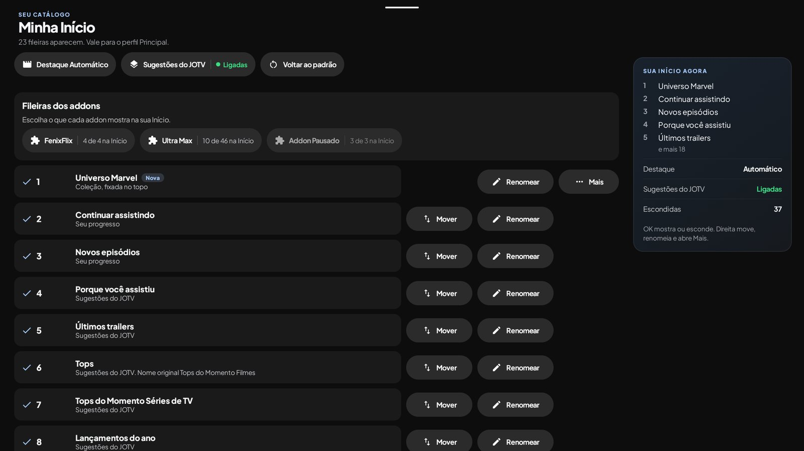
</p>

### Torrent sem debrid também na TV LG, no Windows e no Linux

Fonte de torrent agora toca direto na **TV LG** (webOS recente, que roda Node 20 no serviço do app) e no **Windows e Linux**, sem conta de debrid, como o Android já fazia. O vídeo começa enquanto baixa e só o arquivo escolhido é baixado. Na LG o motor fica na memória, não grava no disco e não envia nada. No Windows e no Linux tudo é apagado ao parar e o envio fica limitado a 2 MB/s. A espera depende de ter gente compartilhando o torrent. Na Samsung o P2P é **experimental** e vem desligado, e com debrid o torrent pronto continua tocando na hora.

### Menus à sua escolha

Em Configurações, Aparência, cada perfil escolhe o menu da TV e do computador. **Lateral** é o de sempre, **Superior** é uma barra no alto, com uma fileira inteira na Início e a seguinte espiando embaixo para mostrar que há mais listas, e **Oculto** esconde a lateral até você ir para o lado esquerdo (no Windows e no Linux, o mouse na borda esquerda também abre).

### Mais leve na LG

A Início e a troca de tela ficaram mais rápidas na LG, porque as fileiras fora da tela e as telas escondidas deixam de refazer o layout a cada passo. Na 55QNED70, medido com teclas automáticas, trocar de fileira ficou perto de duas vezes mais rápido e a volta do detalhe para a Início, no pior caso, caiu de cerca de 2 s para 0,2 s.

### Coleções no formato do Nuvio

Pastas temáticas na Início, como Marvel, Pixar, uma franquia, um canal de streaming ou a obra de um
diretor. Cada pasta junta catálogos de addon e listas do TMDB e abre com uma aba por fonte e a aba
**Tudo**, que intercala as fontes sem repetir título. No celular dá para criar e editar tudo. Na TV as
coleções chegam pela **conta Nuvio**, por **link** ou **colando o JSON**, que é o mesmo arquivo do
Nuvio, então entra e sai igual.

<p align="center">
  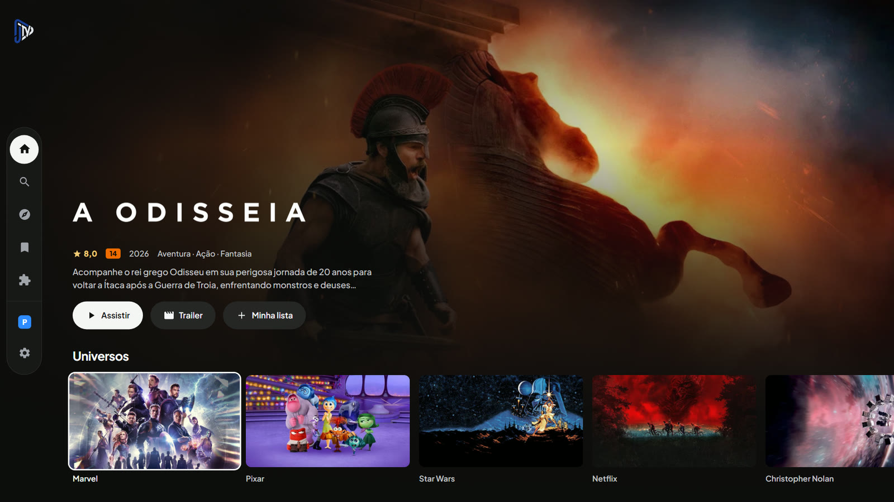
</p>

<p align="center">
  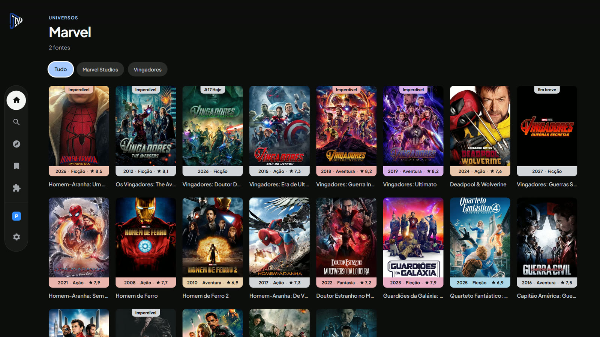
</p>

### Fontes que se explicam

Cada versão do vídeo vira um cartão com resolução, HDR, Dolby Vision, Atmos, canais de áudio e
idioma (Dublado, Legendado, Dual áudio). O app testa as fontes antes de tocar, marca a **melhor
opção**, junta o mesmo arquivo achado em addons diferentes e passa para a próxima quando uma falha.

<p align="center">
  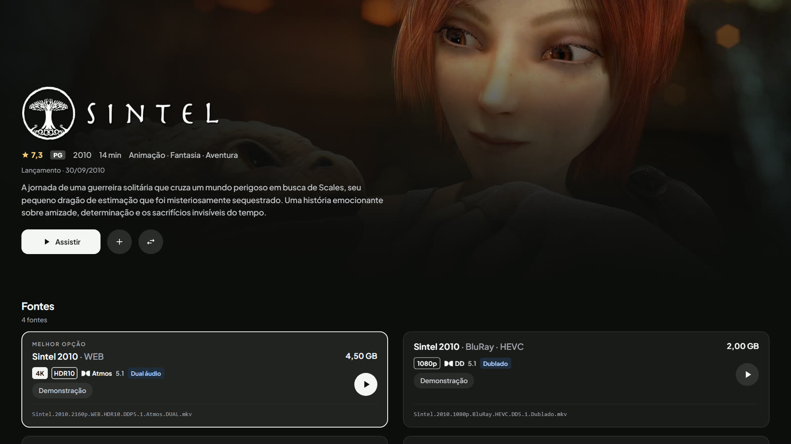
</p>

### TV ao vivo

Listas **M3U**, contas **Xtream** e addons com canais, com guia de programação **XMLTV**,
categorias, favoritos, recentes e busca de canal. No player, o **guia de canais** abre por cima do
vídeo, com a lista e a programação, e o CH+ e o CH- trocam de canal.

<p align="center">
  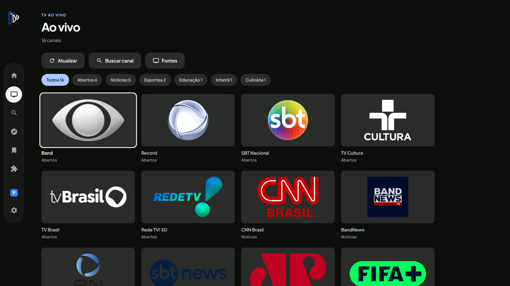
</p>

### E mais

| | |
|---|---|
| **Início do seu jeito** | Ligue, desligue, reordene e renomeie cada fileira, escolha de onde vem o destaque e transforme catálogos de addon em fileiras. Dá até para desligar as Sugestões do JOTV e deixar só os seus addons, e o Voltar ao padrão tem Desfazer. |
| **Contas Stremio e Nuvio** | Entre por e-mail ou pelo QR code e use o Trazer tudo para buscar addons, Minha Lista, o que você estava assistindo, coleções e as chaves de debrid. O QR é gerado no próprio aparelho e o painel O que veio mostra o resultado de cada parte. |
| **Debrid** | Real-Debrid, TorBox e Premiumize. Fonte de torrent que já está pronta no debrid vira link direto e toca na hora, com um raio na lista indicando o que está pronto. |
| **Legenda no seu idioma** | 53 idiomas, começando no português do Brasil, e a opção de a legenda já entrar ligada. O app prefere a legenda do próprio vídeo e completa com o OpenSubtitles e com as legendas dos addons. |
| **Torrent sem debrid** | O Android, o Windows, o Linux e a LG webOS recente têm motor P2P próprio e o vídeo começa enquanto baixa. Na Samsung o P2P é experimental e vem desligado. Com debrid, o torrent pronto toca na hora. |
| **Loja com mouse** | No Windows, no Linux e com o Magic Remote da LG, o clique escolhe o addon e cada cartão tem o próprio botão Instalar, Configurar ou Instalado. Passar o mouse por cima não troca mais a ficha. |
| **Login com QR na TV** | O login por código do Stremio, do Nuvio, do Real-Debrid e do TorBox mostra o QR ao lado do código. É só apontar a câmera do celular. |
| **Player novo no celular** | Controles na base da tela, como na TV, com botões maiores para o toque e espaço certo para a fonte ampliada do sistema. |

## Na TV

Versões próprias para **LG webOS** e **Samsung Tizen** (da TV de 2017 em diante, com o modo Tizen Legacy), leves e
feitas para o controle remoto, e o mesmo APK do celular na **Android TV**.

<table>
  <tr>
    <td width="50%">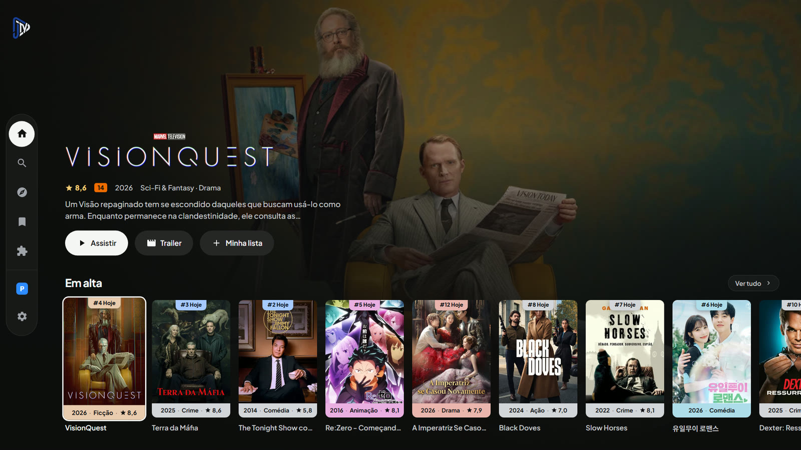<br><b>Início</b><br><sub>Destaque em tela cheia que acompanha o título em foco, com trailer opcional.</sub></td>
    <td width="50%">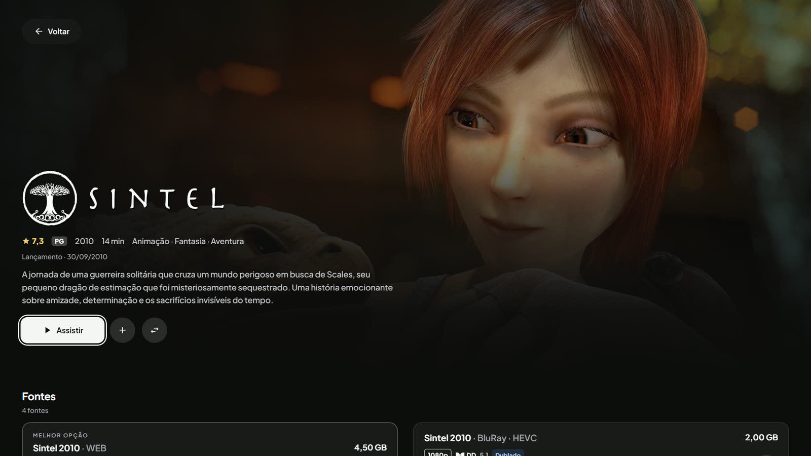<br><b>Detalhe</b><br><sub>Logo do título, nota, classificação, sinopse e o Assistir que já sabe a melhor fonte.</sub></td>
  </tr>
  <tr>
    <td width="50%">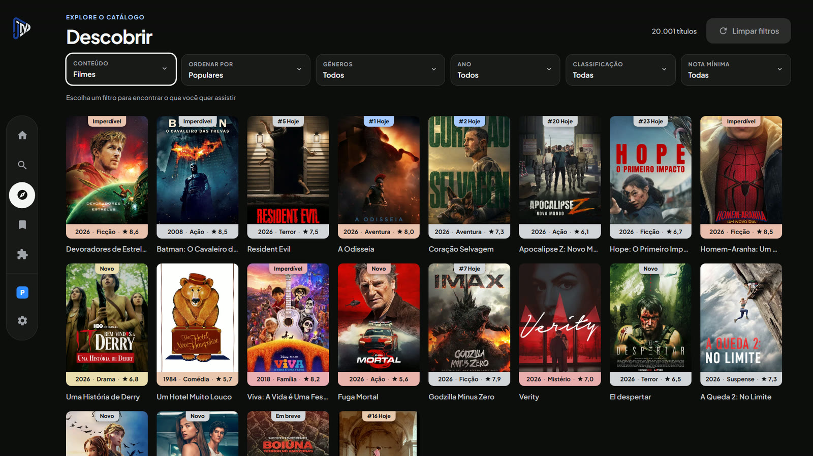<br><b>Descobrir</b><br><sub>Filtros de conteúdo, ordem, gênero, ano, classificação e nota mínima, ou os catálogos e filtros dos seus addons.</sub></td>
    <td width="50%">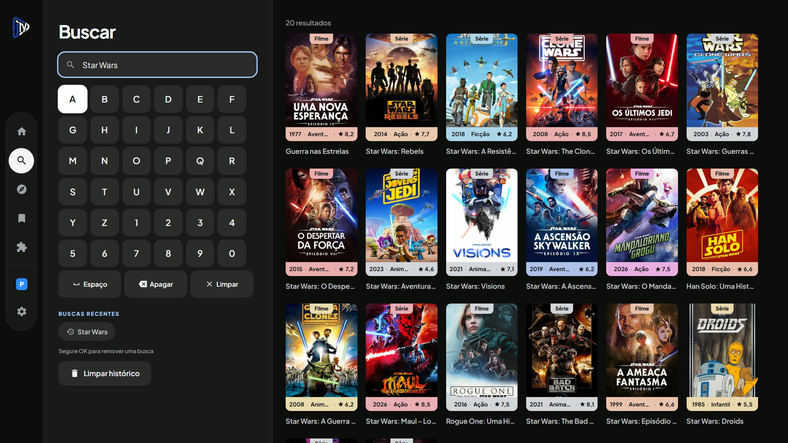<br><b>Busca</b><br><sub>Teclado na tela pensado para o controle e buscas recentes.</sub></td>
  </tr>
  <tr>
    <td width="50%">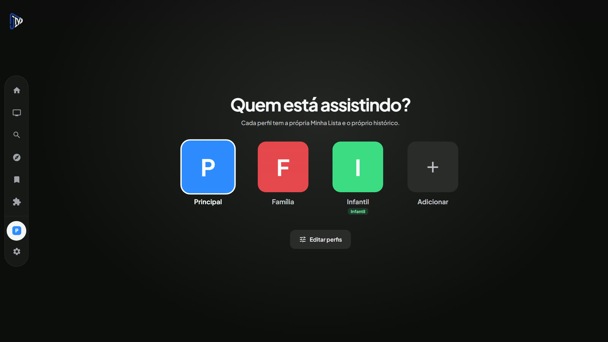<br><b>Perfis</b><br><sub>Cada perfil com a própria lista e o próprio histórico, e o perfil infantil.</sub></td>
    <td width="50%">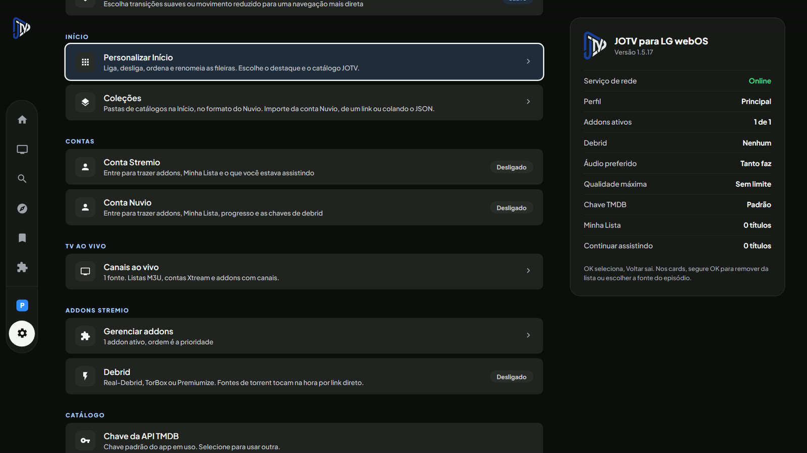<br><b>Configurações</b><br><sub>Início, Coleções, contas, TV ao vivo, addons e debrid, com o resumo ao lado.</sub></td>
  </tr>
</table>

## No celular

O mesmo visual da TV, feito para o toque, com a barra em cápsula embaixo. Tem tudo o que a TV tem e
mais o editor de coleções, downloads, Chromecast e Picture in Picture. No player, os controles ficam no centro da tela e o Melhorar imagem é opcional.

<p align="center">
  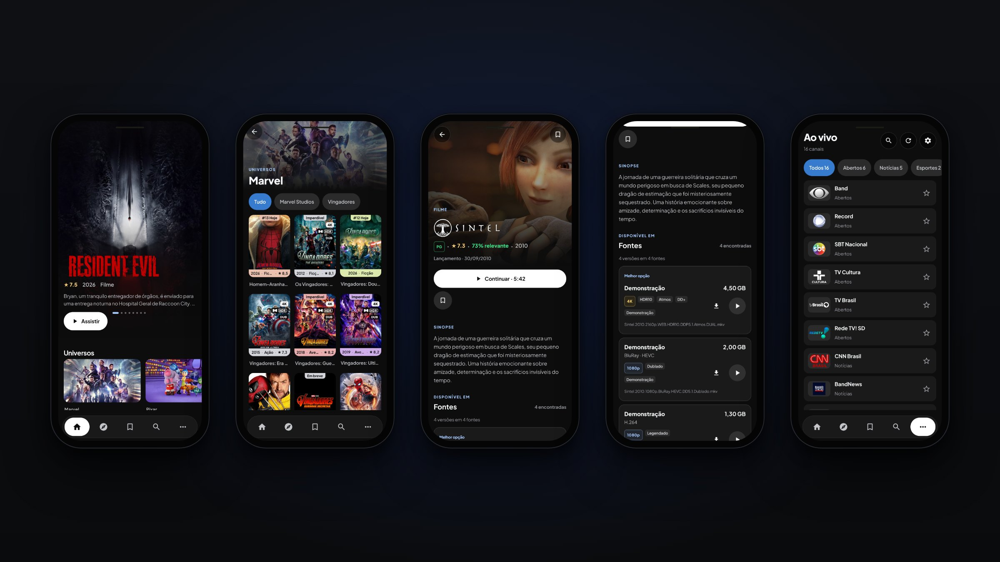<br>
  <sub>Início com a coleção fixada, pasta Marvel com a aba Tudo, detalhe, lista de fontes e TV ao vivo</sub>
</p>

## No Windows

O mesmo app da TV no computador, leve e em tela cheia, com o vídeo tocando no mpv e os controles do
player iguais aos da TV. Funciona com teclado (setas, Enter e Esc) e com mouse. Para sair da tela
cheia, aperte F11 ou leve o mouse ao topo da tela, que aparecem os botões de sair da tela cheia,
minimizar e fechar. Torrent toca sem debrid pelo motor P2P embutido, e os menus Lateral, Superior e
Oculto funcionam com o mouse. O botão Melhorar imagem do player abre um painel completo para ampliar e limpar a imagem com shaders no mpv, com o Auto, os modelos do Anime4K, filtros de cor e o Comparar, desligado por padrão. Desde o 0.2.17 a interface é pensada para o mouse, com dica ao passar, fundo no lugar do zoom, volume e barra de progresso com tempo.

## No Linux

O mesmo visual e os mesmos controles de computador do Windows 0.2.17, com player libmpv integrado por OpenGL.
Teclado, mouse, clique direito, volume na tela, rótulos das ações e o painel completo Melhorar imagem acompanham a versão.
F11 ou Alt+Enter alternam a tela cheia, e a barra no topo permite minimizar e fechar.

Os instaladores completos para x64 e ARM64 levam player, codecs e bibliotecas e criam um atalho na conta atual.
Não precisam de FUSE nem de instalação manual das dependências do aplicativo. Os pacotes Debian continuam disponíveis
para amd64 e arm64 e usam bibliotecas da distribuição. Addons, plugins, perfis, Minha Lista, histórico, coleções,
preferências e backup JSON permanecem compatíveis. O atualizador distingue formato e arquitetura.

Na 0.2.2 o Ao Vivo deixa de piscar e a interface é pensada para o mouse, como no Windows 0.2.17.
Na 0.2.1 o app confere o EGL antes de abrir e, se o EGL do sistema não abrir, usa a renderização por software em vez de deixar a janela preta.
Na 0.2.0, HTTP e torrent/P2P passam com vídeo real de teste. A janela nativa passa em 16 verificações em 720p, 1080p e na VM EndeavourOS.
Instalação, abertura e desinstalação passam em Ubuntu 22.04, Ubuntu 20.04, Alpine 3.22 e Ubuntu ARM64 emulado.
Usenet é validado com respostas controladas do TorBox. ARM64 físico, todas as GPUs, áudio físico ou multicanal,
HDMI e HDR permanecem fora da cobertura. É necessário um desktop com X11 ou XWayland.

## No Roku

O mesmo visual do webOS na TV Roku, escrito em BrightScript. Funciona pelo controle remoto, com a barra lateral, a Início com
destaque, o detalhe com as fontes dos seus addons e o player do Roku com legenda, escolha de áudio e retomada de onde parou. O
debrid (Real-Debrid, TorBox e Premiumize) transforma o torrent pronto em link direto. O Roku não roda JavaScript nem motor de
torrent, então ficam de fora o P2P sem debrid, os plugins, o trailer do YouTube, o áudio de outra fonte, os downloads e o
Chromecast. Para torrent use um addon com debrid. A versão 1.0.4 foi provada em simulador e em testes das bibliotecas, e ainda
não rodou num Roku físico. Não tem aviso de atualização, então baixe o zip novo e instale por cima.

## Tudo o que o app faz

<details open>
<summary><b>Catálogo e descoberta</b></summary>

- Início com destaque em tela cheia, trailer opcional que toca sem som depois de alguns segundos, Continuar assistindo e Novos episódios
- Fileiras de tendências, populares, nos cinemas, lançamentos do ano, trailers e gêneros, todas do TMDB
- Descobrir com filtros de conteúdo, ordem, gênero, ano, classificação e nota mínima
- Busca de filmes e séries com buscas recentes
- Detalhe com elenco, temporadas, episódios, recomendações e a franquia do filme
- Logo do título em português quando existe, notas com vírgula e classificação indicativa do Brasil

</details>

<details>
<summary><b>Fontes e player</b></summary>

- Escolha automática da melhor fonte pelo áudio preferido (dublado, legendado ou tanto faz) e pela qualidade máxima
- Teste rápido das fontes, com troca automática quando uma não responde
- Lista de fontes com selos de resolução, HDR, Dolby Vision, Atmos, DTS e idioma
- Som de outra fonte sincronizado, para assistir uma versão ouvindo o áudio dublado de outra
- Pula a abertura que você já pulou uma vez e passa para o próximo episódio sozinho
- Legenda com tamanho, fundo e atraso ajustáveis, em 53 idiomas
- Player do celular com os controles na base, como na TV, e botões grandes para o toque
- Prévia em miniatura ao arrastar a barra (celular)
- Chromecast, Picture in Picture e controle pela tela bloqueada ou pelo fone (celular)
- Download para assistir sem internet (celular)
- DNS seguro da Cloudflare nos links de vídeo, para fugir de bloqueio de operadora (celular)

</details>

<details>
<summary><b>Addons</b></summary>

- Gerenciador com ordem de prioridade, liga e desliga
- Loja com o catálogo da comunidade
- Configuração no site do addon, com QR code para configurar pelo celular e levar o link pronto para a TV
- Catálogos dos addons viram fileiras da Início, com o painel Fileiras para escolher quais aparecem (um addon novo entra com 10)
- Você decide quais addons usar. O app começa sem nenhum, no celular e na TV, e você instala pelo link do manifest, pela Loja ou trazendo da sua conta Stremio ou Nuvio

</details>

<details>
<summary><b>Plugins</b></summary>

- Gerenciador em Configurações, Plugins (perfil adulto), que começa vazio e só instala o que você colar
- Repositório JavaScript no formato do Nuvio, arquivo JavaScript individual ou addon Stremio
- Provedor novo começa desligado, com ativação, configurações próprias e teste de fontes
- Busca, filtros, ordem de prioridade, atualização com conferência diária, backup e limpeza do cache
- As fontes entram na lista de fontes e no player, com os cabeçalhos HTTP e as legendas
- Busca em paralelo (até 32 ao mesmo tempo), com cada fonte aparecendo assim que chega, e cache curto
- Código isolado no QuickJS, com limites de memória, tempo, rede e dados

</details>

<details>
<summary><b>Coleções</b></summary>

- Fontes de addon e do TMDB (lista, franquia, estúdio, canal, descoberta com filtros, ator e direção)
- Pasta com abas e aba Tudo, ou uma fileira por fonte
- Capa, emoji, GIF animado e formato pôster, paisagem ou quadrado
- Coleção fixada no topo da Início
- Editor completo no celular, com atalhos para estúdios e canais conhecidos e busca no TMDB
- Importa o mesmo JSON do Nuvio pela conta Nuvio, por link ou colando o texto, e exporta pelo celular

</details>

<details>
<summary><b>Contas, debrid e torrent</b></summary>

- Stremio e Nuvio por e-mail ou QR, importando addons, Minha Lista, progresso e as chaves de debrid salvas na conta
- WeTrakr, MDBList e Simkl por código de dispositivo, avisando o que você assiste e trazendo Minha Lista, o que ficou pela metade e os episódios vistos
- Real-Debrid (por código ou chave), TorBox e Premiumize
- Motor P2P no Android, no Windows, no Linux e na LG webOS recente, com o vídeo tocando enquanto baixa
- Na Samsung o P2P é experimental e vem desligado, e sem ele o torrent toca pelo debrid
- Trazer tudo e painel O que veio mostram o resultado de cada parte importada, com o registro por perfil

</details>

<details>
<summary><b>TV ao vivo</b></summary>

- Listas M3U, contas Xtream e addons com canais
- Guia XMLTV (inclusive compactado em .gz no celular e na LG)
- Categorias, favoritos, recentes e busca de canal
- Guia de canais dentro do player, com a lista e a programação por cima do vídeo, e troca de canal pelo CH+ e CH-, com o programa atual na tela
- Na Android TV, filtros por favoritos, recentes, fonte e grupo, busca por canal ou programa, troca pelo número do canal e o 0 para voltar ao anterior
- Addons com canais ao vivo entram como fonte, com o nome Addon ao vivo
- A aba Ao vivo só aparece depois que você cadastra uma fonte

</details>

<details>
<summary><b>Perfis e família</b></summary>

- Vários perfis, cada um com Minha Lista, histórico, progresso e preferências
- Perfil infantil que só mostra animação e família e bloqueia título acima de 12 anos
- PIN dos pais para sair do infantil e mexer em perfis e ajustes
- TV ao vivo, catálogos de addon e coleções ficam fora do perfil infantil

</details>

<details>
<summary><b>Feito para cada tela</b></summary>

- Celular, tablet e Android TV no mesmo APK, com layout próprio para o controle remoto na TV
- LG webOS e Samsung Tizen em app próprio, leve e sem framework
- Windows 10 e 11 em app próprio, com a interface da TV e o player mpv
- Linux x86_64 em app próprio, com a interface do Windows e player libmpv integrado por OpenGL
- Navegação inteira pelo controle, com foco sempre visível e retorno ao card de onde você saiu
- Temas Grafite, Azul e Verde e opção de movimento reduzido (TV)
- Menus Lateral, Superior e Oculto por perfil, na TV e no computador
- Tamanho da interface (Padrão, Médio e Grande) por perfil na Android TV
- Medidor de quadros em Configurações, Diagnóstico, para medir o desempenho no próprio aparelho (Android)

</details>

## Instalação

Todos os arquivos ficam na página de **[Releases](../../releases)**. Não precisa compilar nada.
O Android, a LG, a Samsung e o Windows estão na [release v1.0.24](https://github.com/LucasR0cha/JOTV-Android/releases/tag/v1.0.24). O Linux e o Roku têm cada um a sua release, a [linux-v0.2.2](https://github.com/LucasR0cha/JOTV-Android/releases/tag/linux-v0.2.2) e a [roku-v1.0.4](https://github.com/LucasR0cha/JOTV-Android/releases/tag/roku-v1.0.4).

| Aparelho | Arquivo | Precisa de |
|---|---|---|
| Celular ou tablet Android | `JOTV-v*.apk` | Android 6 ou mais novo |
| Android TV e Google TV | `JOTV-v*.apk` | Android TV 6 ou mais novo |
| TV LG | `JOTV-webOS-v*.ipk` | webOS 4 ou mais novo, em modo desenvolvedor |
| TV Samsung | `JOTV-Tizen-v*.wgt` | Tizen 3.0 ou mais novo (TVs de 2017 em diante), em modo desenvolvedor. De 2017 a 2019 abre no modo Tizen Legacy, sem Plugins e P2P |
| Computador | `JOTV-Windows-v*-setup.exe` | Windows 10 ou 11 de 64 bits |
| Linux Intel ou AMD de 64 bits | `JOTV-Linux-v*-x86_64-setup.run` | Desktop com X11 ou XWayland. Player e bibliotecas incluídos |
| Linux ARM64 ou AArch64 | `JOTV-Linux-v*-aarch64-setup.run` | Desktop com X11 ou XWayland. Player e bibliotecas incluídos |
| Linux Debian ou Ubuntu compatível | `JOTV-Linux-v*-amd64.deb` ou `JOTV-Linux-v*-arm64.deb` | Bibliotecas da distribuição e X11 ou XWayland |
| TV ou aparelho Roku | `JOTV-Roku-v*.zip` | Roku com o modo desenvolvedor ligado |

<details>
<summary><b>Celular ou tablet Android</b></summary>

1. Baixe o `.apk` da Release direto no aparelho.
2. Abra o arquivo. Na primeira vez o Android pede para liberar a instalação de fonte desconhecida no app que você usou para baixar (navegador ou Arquivos). Libere e confirme.

O APK é para aparelhos ARM, que são quase todos os celulares, tablets e TV boxes. Emulador de computador (MuMu, MEmu, BlueStacks) roda pela tradução do próprio emulador.

</details>

<details>
<summary><b>Android TV e Google TV (qualquer marca)</b></summary>

Vale para Sony, TCL, Philips, Hisense, Xiaomi, NVIDIA Shield, Chromecast com Google TV, Fire TV e
qualquer aparelho com Android TV. A instalação é por sideload, de um destes jeitos.

**Pelo computador, com ADB.** Na TV, libere as opções do desenvolvedor (em geral tocando várias vezes
na versão do sistema em Configurações, Sobre) e ligue a depuração de rede. No PC, com o
[Android Platform Tools](https://developer.android.com/tools/releases/platform-tools) instalado,

```sh
adb connect <ip-da-tv>:5555
adb install JOTV-v<versão>.apk
```

**Direto na TV.** Instale um app como o Downloader ou o Send Files to TV pela loja da própria TV,
baixe o `.apk` por ele e instale.

</details>

<details>
<summary><b>TV LG (webOS)</b></summary>

1. Na TV, instale o app **Developer Mode** pela LG Content Store, entre com uma conta grátis de [developer.lge.com](https://developer.lge.com) e ligue o modo desenvolvedor e o Key Server. Anote o IP e a frase (passphrase) que aparecem na tela.
2. No computador, instale a [CLI do webOS TV](https://webostv.developer.lge.com/develop/tools/cli-installation) (precisa do Node.js) e cadastre a TV uma vez.
   ```sh
   npm install -g @webos-tools/cli
   ares-setup-device
   ```
3. Instale e abra o app.
   ```sh
   ares-install --device <nome-da-tv> JOTV-webOS-v<versão>.ipk
   ares-launch --device <nome-da-tv> com.joabtv.app
   ```

O modo desenvolvedor desliga sozinho depois de alguns dias. Se o app sumir, abra o Developer Mode e
renove a sessão (o IP e a frase podem mudar).

</details>

<details>
<summary><b>TV Samsung (Tizen)</b></summary>

1. Na TV, abra a área de Apps, digite **1 2 3 4 5** no controle e ligue o modo desenvolvedor com o IP do seu computador. Reinicie a TV.
2. No computador, instale o [Tizen Studio](https://samsungtizenos.com/tools-download/) (o instalador de linha de comando basta). Ele traz o `sdb`.
3. Conecte e instale.
   ```sh
   sdb connect <ip-da-tv>:26101
   sdb install JOTV-Tizen-v<versão>.wgt
   ```

O `.wgt` sai assinado com certificado de desenvolvedor, o que basta para uso pessoal em modo
desenvolvedor. Ele não serve para a loja da Samsung.

O mesmo arquivo serve para qualquer TV com Tizen 3.0 ou mais novo. Em TVs de 2017 a 2019 (Tizen 3.0, 4.0 e 5.0)
ele abre no modo **Tizen Legacy**, sem Plugins e sem P2P. Em TVs de 2020 em diante abre no modo completo.
A TV de 2016 (Tizen 2.4) não é atendida.

</details>

<details>
<summary><b>Windows</b></summary>

1. Baixe o `JOTV-Windows-v<versão>-setup.exe` da [release v1.0.24](https://github.com/LucasR0cha/JOTV-Android/releases/tag/v1.0.24) e abra.
2. O instalador não tem assinatura digital paga, então o Windows pode avisar que protegeu o computador. Clique em **Mais informações** e depois em **Executar assim mesmo**.
3. O JOTV abre em tela cheia. F11 ou Alt+Enter alternam a tela cheia, e o mouse no topo da tela mostra os botões de sair da tela cheia, minimizar e fechar.

</details>

<details>
<summary><b>Linux</b></summary>

Na [release Linux 0.2.2](https://github.com/LucasR0cha/JOTV-Android/releases/tag/linux-v0.2.2), escolha o instalador completo do processador.

- [Intel ou AMD de 64 bits](https://github.com/LucasR0cha/JOTV-Android/releases/download/linux-v0.2.2/JOTV-Linux-v0.2.2-x86_64-setup.run)
- [ARM64 ou AArch64](https://github.com/LucasR0cha/JOTV-Android/releases/download/linux-v0.2.2/JOTV-Linux-v0.2.2-aarch64-setup.run)

1. Feche o JOTV. Nas propriedades do arquivo, habilite a permissão de execução.
2. Abra o instalador e escolha **Instalar e abrir**. A instalação vale para a conta atual e dispensa senha de administrador.
3. Nas próximas vezes, use **JOTV** no menu de aplicativos.

Se o arquivo abrir como texto, execute na pasta do download. Esse comando dispensa marcar a permissão de execução.

```sh
sh ./JOTV-Linux-v0.2.2-x86_64-setup.run
```

No ARM64, troque pelo nome do arquivo AArch64. Player, codecs, fontes, WebKitGTK e bibliotecas já vêm no pacote.
Não é necessário FUSE nem instalar manualmente as dependências do aplicativo. É necessário X11 ou XWayland.

Quem usa AppImage deve executar o novo instalador uma vez. Perfis e configurações são preservados.
O menu do atalho oferece **Desinstalar JOTV**, mantendo os dados da conta. Faça um backup nas Configurações antes de trocar de aparelho.

Os pacotes [amd64.deb](https://github.com/LucasR0cha/JOTV-Android/releases/download/linux-v0.2.2/JOTV-Linux-v0.2.2-amd64.deb)
e [arm64.deb](https://github.com/LucasR0cha/JOTV-Android/releases/download/linux-v0.2.2/JOTV-Linux-v0.2.2-arm64.deb)
também estão disponíveis para Debian, Ubuntu e compatíveis. Eles usam as bibliotecas da distribuição.
As versões Linux têm numeração independente das outras plataformas.

</details>

<details>
<summary><b>Roku</b></summary>

1. Na TV, ligue o modo desenvolvedor. Aperte no controle Início três vezes, Cima duas, Direita, Esquerda, Direita, Esquerda, Direita. Anote o endereço IP, crie uma senha e confirme.
2. Baixe o `JOTV-Roku-v1.0.4.zip` da [release do Roku](https://github.com/LucasR0cha/JOTV-Android/releases/tag/roku-v1.0.4).
3. Abra `http://` seguido do IP da TV no navegador do computador, entre com o usuário `rokudev` e a senha criada, escolha o zip e instale.

O canal fica na lista de aplicativos como JOTV. O modo desenvolvedor mantém o canal até a TV ser reiniciada com a opção desligada.

</details>

<details>
<summary><b>Apple TV ou outra TV sem Android, webOS, Tizen ou Roku</b></summary>

Essas não têm versão própria. Ligue um aparelho com Android TV na entrada HDMI (um Chromecast com
Google TV, um TV Box Android ou um Fire TV Stick) e instale o APK nele. A TV vira só a tela.

</details>

## Para desenvolvedores

Este repositório traz o código do app Android (celular, tablet e Android TV). As versões de LG,
Samsung, Windows e Linux saem como pacote pronto nas Releases.

<details>
<summary><b>Como o app é feito</b></summary>

```
UI (Jetpack Compose)  →  ViewModel (Hilt)  →  Repository  →  Room / Retrofit (TMDB) / addons Stremio (OkHttp)
```

- Jetpack Compose com Material 3 e `androidx.tv` para a TV. Uma árvore só de telas se adapta ao celular, ao tablet e à TV.
- Hilt para injeção de dependência e Room para perfis, Minha Lista, histórico, episódios vistos e downloads.
- Preferências por perfil em `PlatformPrefs`, inclusive a Início personalizada e as coleções.
- Media3 (ExoPlayer) com `MediaSession` e Chromecast, e libtorrent4j no motor P2P.
- Retrofit e OkHttp para o TMDB, com DNS seguro para os links de vídeo dos addons.
- O motor de plugins roda num WebView interno com Workers e QuickJS, sem acesso ao app. O código fica em `data/plugins` e as bibliotecas em `assets/plugins`.

</details>

<details>
<summary><b>Como compilar</b></summary>

Precisa do **JDK 17** (ou do JBR do Android Studio) e do Android SDK. Crie um `local.properties` na
raiz, que não entra no Git,

```properties
sdk.dir=/caminho/para/o/Android/Sdk
```

A chave do TMDB pode ir no `~/.gradle/gradle.properties` como `TMDB_API_KEY`. Depois,

```sh
./gradlew installDebug          # instala num aparelho conectado
./gradlew assembleRelease       # APK de release em app/build/outputs/apk/release/
./gradlew testDebugUnitTest     # testes
```

O APK de release leva só ARM. Para testar num emulador x86, use o `installDebug`, que leva também as
bibliotecas x86.

Sem a `TMDB_API_KEY` o app abre pedindo a sua chave do TMDB em Configurações. O APK das Releases já
vem com uma chave pronta. A sincronia com o
Trakt liga quando `TRAKT_CLIENT_ID` e `TRAKT_CLIENT_SECRET` estão no `local.properties`. Chave do
TMDB em [themoviedb.org/settings/api](https://www.themoviedb.org/settings/api) e app do Trakt em
[trakt.tv/oauth/applications](https://trakt.tv/oauth/applications).

</details>

<details>
<summary><b>Estrutura do projeto</b></summary>

```
app/src/main/java/com/joabtv/app/
├── data/
│   ├── accounts/      contas Stremio e Nuvio e o registro de importação
│   ├── collections/   coleções no formato do Nuvio
│   ├── debrid/        Real-Debrid, TorBox e Premiumize
│   ├── live/          M3U, Xtream e guia XMLTV
│   ├── local/         Room e preferências por perfil
│   ├── plugins/       gerenciador e motor de plugins
│   ├── remote/        TMDB, addons Stremio, legendas e DNS seguro
│   ├── repository/    biblioteca e downloads
│   └── torrent/       motor P2P
├── di/                módulos Hilt
├── domain/model/      filme, série, episódio e elenco
└── ui/
    ├── collections/   coleções, pasta e editor
    ├── common/        componentes e layout adaptável
    ├── live/          TV ao vivo
    ├── movies/        Início, detalhe, busca e player
    ├── navigation/    navegação e menus da TV (lateral, superior e oculto)
    ├── settings/      Seu catálogo, Minha Início, addons, plugins, contas, debrid e perfis
    ├── theme/         cores e tipografia
    └── tv/            telas exclusivas da TV
```

</details>

## Aviso legal

O JOTV não hospeda, não distribui e não guarda vídeo nenhum. Ele é um player e uma interface para
addons de terceiros no protocolo Stremio e para plugins de terceiros, que a própria pessoa escolhe
instalar. O JOTV não traz nem recomenda nenhum plugin. O uso e a legalidade das fontes acessadas por
esses addons e plugins são responsabilidade de quem os instala.

Este produto usa a API do TMDB, mas não é endossado nem certificado pelo TMDB. As capturas usam
dados públicos do TMDB, canais abertos e o filme aberto Sintel, da Blender Foundation (CC BY 3.0),
numa fonte de demonstração.

## Licença

[Apache License 2.0](LICENSE)

O instalador de Windows leva o [mpv](https://mpv.io) como programa separado, que é software livre
sob a GPL. O código do mpv fica em [mpv-player/mpv](https://github.com/mpv-player/mpv) e a build
usada vem de [zhongfly/mpv-winbuild](https://github.com/zhongfly/mpv-winbuild/releases/tag/2026-10-26-baa3e11d42).

O Linux usa a [libmpv](https://github.com/mpv-player/mpv). O pacote Debian depende da biblioteca da
distribuição, e o instalador completo inclui a biblioteca, suas dependências e os arquivos de licença.
O código-fonte do pacote Ubuntu fica na [página do mpv no Launchpad](https://launchpad.net/ubuntu/+source/mpv).

O motor de plugins leva o QuickJS e bibliotecas JavaScript de código aberto. As licenças ficam em
`app/src/main/assets/plugins/LICENSES.txt`.

Para compilar a integração Simkl, configure a propriedade Gradle `SIMKL_CLIENT_ID` com o identificador público do aplicativo.
