<div align="center">

<picture>
  <source media="(prefers-color-scheme: dark)" srcset="docs/readme/logo-escuro.png">
  
</picture>

# JOTV

**Filmes, séries e TV ao vivo no celular e na televisão.**

Um app só para celular, tablet, Android TV, LG webOS, Samsung Tizen e Windows.<br>
O catálogo vem do TMDB, em português. Os vídeos vêm dos addons e dos plugins que você escolhe.

[](../../releases/latest)
[](../../releases/latest)
[](../../releases/latest)
[](../../releases/latest)

[Novidades](#novidades) · [Na TV](#na-tv) · [No celular](#no-celular) · [No Windows](#no-windows) · [Tudo o que o app faz](#tudo-o-que-o-app-faz) · [Instalação](#instalação) · [Para desenvolvedores](#para-desenvolvedores)

</div>

<p align="center">
  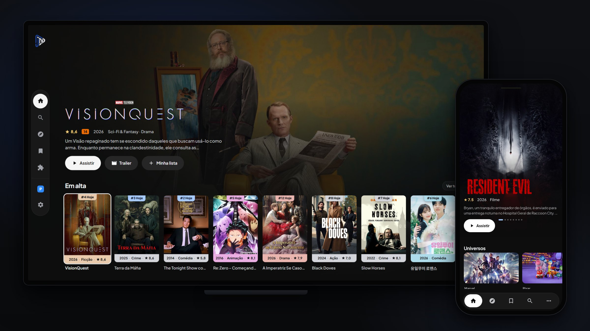
</p>

## O que é o JOTV

O JOTV junta num lugar só tudo o que você assiste. Capas, sinopses, elenco, trailers e notas vêm do
**TMDB**, sempre em português. Os vídeos vêm dos **addons no padrão Stremio** e dos **plugins** que você instala, e o
app escolhe sozinho a melhor fonte para o seu gosto (dublado ou legendado, até a qualidade que você
definir). Na TV tudo funciona pelo controle remoto, no celular pelo toque, e cada pessoa da casa tem o
próprio perfil com lista, histórico e progresso.

O JOTV não hospeda nem distribui vídeo nenhum. Leia o [aviso legal](#aviso-legal).

## Novidades

### Plugins mais rápidos

Os provedores ativos agora são consultados em paralelo, com até 32 buscas ao mesmo tempo, e cada fonte entra na lista assim que chega, sem esperar os provedores mais lentos. A inicialização ficou mais leve, porque poucos motores isolados atendem várias buscas, e as respostas ficam num cache curto (30 segundos, ou 2 segundos quando a busca volta vazia). Os provedores e as configurações foram preservados. Quem já usava plugins passa para **Buscar em paralelo** uma vez, e em Preferências dá para voltar para um ou dois de cada vez. Os tempos foram medidos só em testes controlados, com provedores simulados, no navegador e num emulador Android, e não em TV nem em celular reais.

### Plugins

O JOTV agora aceita plugins. Em Configurações, Plugins, você adiciona por link repositórios de provedores no formato do Nuvio, e as fontes deles entram na lista de fontes e no player como as dos addons. O gerenciador começa **vazio**. O JOTV não traz, não indica e não instala plugin nenhum, e cada pessoa cola só os links que quiser (no perfil adulto). O gerenciador existe no Android, na LG, na Samsung e no Windows.

Aceita três formatos.

- Repositório JavaScript no formato do Nuvio, com `scrapers`, `providers` ou `plugins` no manifesto, pelo endereço do GitHub ou pelo link direto do JSON
- Arquivo JavaScript individual
- Addon Stremio, que segue para o gerenciador de addons

Provedor novo começa desligado. Cada um tem ativação, configurações próprias (as senhas ficam mascaradas), teste de carregamento e teste de fontes. A lista tem busca e filtros, ordem de prioridade, atualização individual ou em conjunto com conferência diária, pausa, remoção e **backup** dos links, da ordem e da ativação (as configurações dos provedores não entram). Os cabeçalhos HTTP e as legendas externas acompanham a reprodução.

O código do plugin roda isolado, num QuickJS dentro de um Worker, sem acesso ao DOM, ao armazenamento do app, a arquivos nem a processos. Cada execução tem 48 MiB de memória, até 120 segundos, 80 chamadas de rede e 24 MiB de respostas. No Android e no Windows, e na LG com o serviço do app ativo, as chamadas de rede feitas pelo código do plugin só alcançam endereços públicos, com o DNS e cada redirecionamento conferidos. Na Samsung (e na LG quando o serviço do app não responde) o navegador da TV faz a conexão, e a conferência vale só para o endereço escrito, então um redirecionamento ou um nome que aponte para a rede de casa não é barrado. O vídeo e as legendas que o plugin indica são baixados pelo player do app, como nos addons, sem essa conferência. O plugin também recebe o ID do título, as configurações do provedor e a chave do TMDB do app. Plugin é código de terceiros, então instale só de quem você confia.

Extensões CS3, que usam código nativo do Android, não rodam. Na Samsung o navegador da TV barra alguns pedidos e cabeçalhos, e por isso alguns provedores podem não tocar lá.

### Guia de canais dentro do player ao vivo

Na TV ao vivo, a lista de canais e o guia de programação abrem por cima do vídeo, sem sair do player. Na Android TV dá para filtrar por favoritos, recentes, fonte e grupo, buscar pelo nome do canal ou do programa, trocar de canal pelo CH+ e CH- ou digitando o número e apertar 0 para voltar ao canal anterior. Os addons com canais ao vivo agora entram na TV ao vivo como uma fonte **Addon ao vivo**. O guia também chegou à LG, à Samsung e ao Windows.

### Roda também no emulador de computador

O app fechava sozinho ao tocar uma fonte de torrent no MuMu, no MEmu, no BlueStacks e em emuladores parecidos. O pacote agora leva só código ARM e roda pela tradução do próprio emulador. Quando um aparelho não tem o motor de torrent, a fonte falha e o player tenta a próxima, sem derrubar o app.

### Início mais leve no Android

O app vem com um perfil de compilação, então o código roda compilado em vez de interpretado. Os pôsteres deixam de refazer o desenho à toa, o cartão parado vira uma textura só e o destaque troca com menos trabalho. O trailer do destaque toca em 720p H.264 e sem áudio, para não pesar na TV. Em Configurações, Diagnóstico, o **Medidor de quadros** mostra no canto da tela os quadros por segundo e de onde vem o tempo, para medir no seu aparelho.

### Tamanho da interface na TV

Em Configurações, Aparência, cada perfil escolhe o **Tamanho da interface** entre Padrão, Médio e Grande. Aumenta o texto, os cartões e as margens juntos, e serve para TV pequena ou vista de longe.

### Lista de fontes com todos os addons

A lista de fontes mostra resultados de todos os addons já na primeira página. Antes, um addon de torrent com muitos resultados ficava na frente e escondia os dos addons de baixo.

### Seu catálogo, mais fácil de configurar

As Configurações abrem com **Seu catálogo**, cinco cartões que mostram o estado de cada coisa e já trazem o botão da próxima ação. Entrou no Nuvio ou no Stremio, o **Trazer tudo** aparece no próprio cartão, e o painel **O que veio** mostra o que chegou e o motivo de cada parte que não veio. Na **Minha Início** a linha inteira liga e desliga, o modo **Mover** troca a ordem (na TV pelas setas, no celular por Para o topo e Para o fim), e dá para renomear, escolher o destaque em lista e **Voltar ao padrão** com Desfazer. Cada addon tem o painel **Fileiras**, e o addon novo entra com as 10 primeiras fileiras para a Início não encher de uma vez. A Início vazia ensina o caminho, com Ligar sugestões, Explorar addons e Organizar a Início.

<p align="center">
  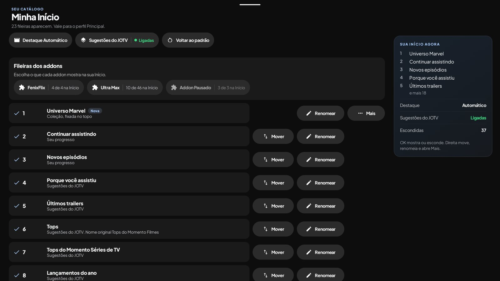
</p>

### Torrent sem debrid também na TV LG e no Windows

Fonte de torrent agora toca direto na **TV LG** (webOS recente, que roda Node 20 no serviço do app) e no **Windows**, sem conta de debrid, como o Android já fazia. O vídeo começa enquanto baixa e só o arquivo escolhido é baixado. Na LG o motor fica na memória, não grava no disco e não envia nada. No Windows tudo é apagado ao parar e o envio fica limitado a 2 MB/s. A espera depende de ter gente compartilhando o torrent. Na Samsung o P2P é **experimental** e vem desligado, e com debrid o torrent pronto continua tocando na hora.

### Menus à sua escolha

Em Configurações, Aparência, cada perfil escolhe o menu da TV e do computador. **Lateral** é o de sempre, **Superior** é uma barra no alto, com uma fileira inteira na Início e a seguinte espiando embaixo para mostrar que há mais listas, e **Oculto** esconde a lateral até você ir para o lado esquerdo (no Windows, o mouse na borda esquerda também abre).

### Mais leve na LG

A Início e a troca de tela ficaram mais rápidas na LG, porque as fileiras fora da tela e as telas escondidas deixam de refazer o layout a cada passo. Na 55QNED70, medido com teclas automáticas, trocar de fileira ficou perto de duas vezes mais rápido e a volta do detalhe para a Início, no pior caso, caiu de cerca de 2 s para 0,2 s.

### Coleções no formato do Nuvio

Pastas temáticas na Início, como Marvel, Pixar, uma franquia, um canal de streaming ou a obra de um
diretor. Cada pasta junta catálogos de addon e listas do TMDB e abre com uma aba por fonte e a aba
**Tudo**, que intercala as fontes sem repetir título. No celular dá para criar e editar tudo. Na TV as
coleções chegam pela **conta Nuvio**, por **link** ou **colando o JSON**, que é o mesmo arquivo do
Nuvio, então entra e sai igual.

<p align="center">
  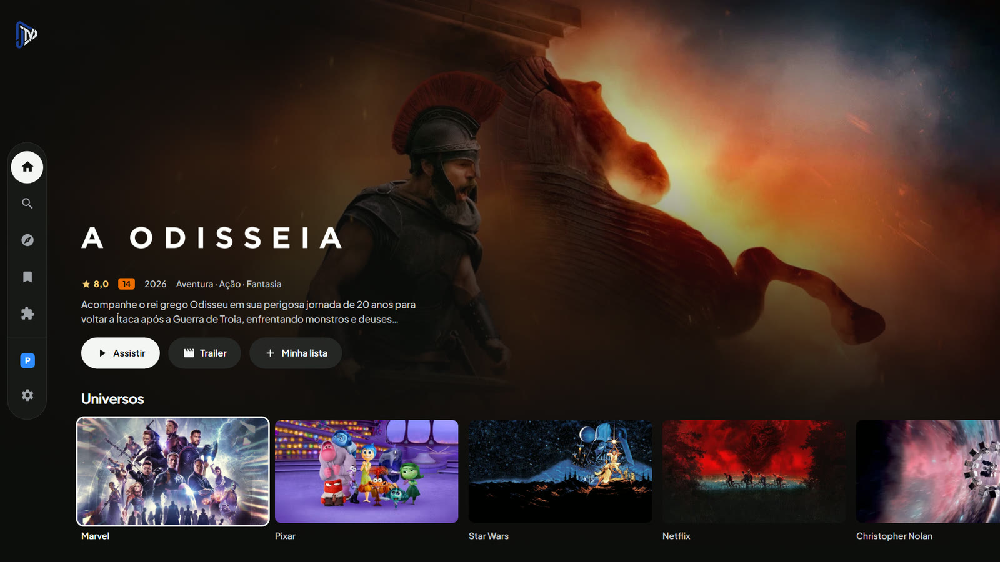
</p>

<p align="center">
  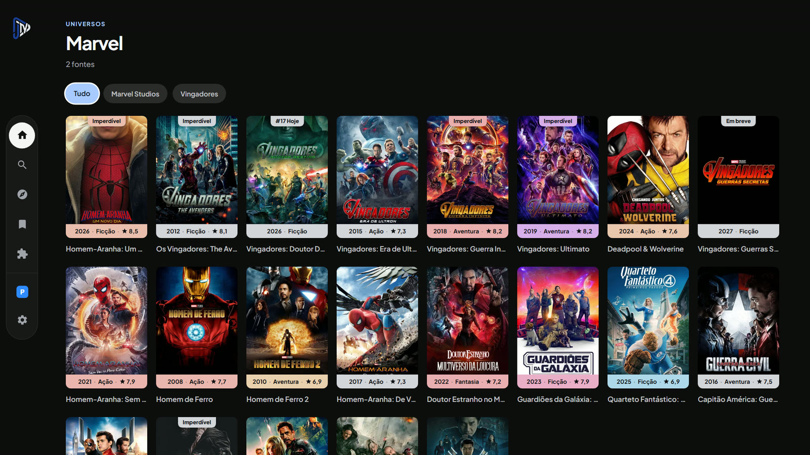
</p>

### Fontes que se explicam

Cada versão do vídeo vira um cartão com resolução, HDR, Dolby Vision, Atmos, canais de áudio e
idioma (Dublado, Legendado, Dual áudio). O app testa as fontes antes de tocar, marca a **melhor
opção**, junta o mesmo arquivo achado em addons diferentes e passa para a próxima quando uma falha.

<p align="center">
  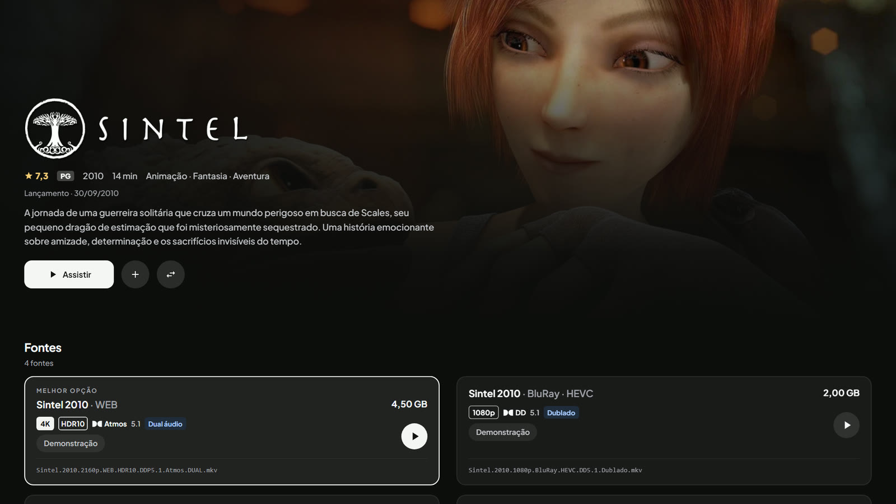
</p>

### TV ao vivo

Listas **M3U**, contas **Xtream** e addons com canais, com guia de programação **XMLTV**,
categorias, favoritos, recentes e busca de canal. No player, o **guia de canais** abre por cima do
vídeo, com a lista e a programação, e o CH+ e o CH- trocam de canal.

<p align="center">
  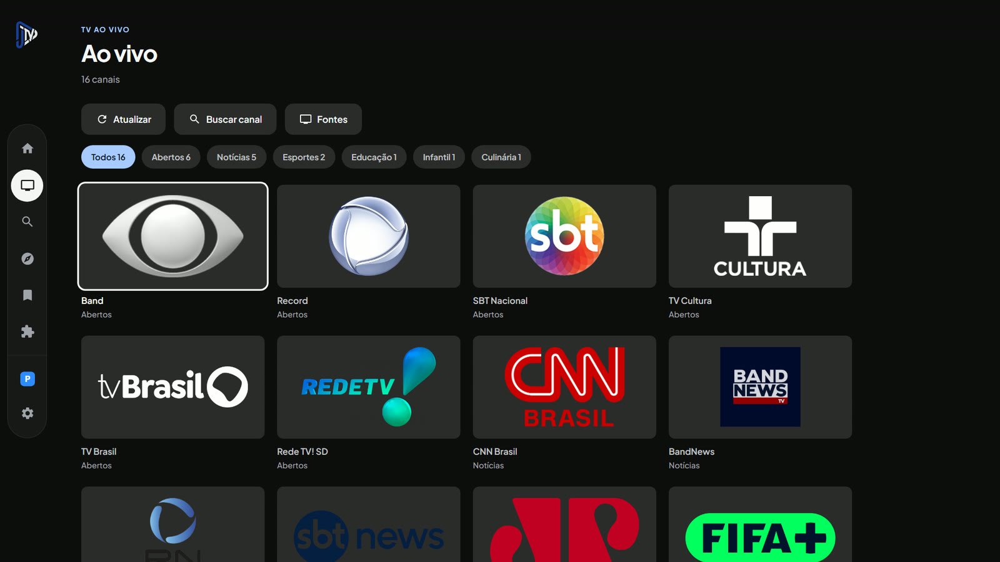
</p>

### E mais

| | |
|---|---|
| **Início do seu jeito** | Ligue, desligue, reordene e renomeie cada fileira, escolha de onde vem o destaque e transforme catálogos de addon em fileiras. Dá até para desligar as Sugestões do JOTV e deixar só os seus addons, e o Voltar ao padrão tem Desfazer. |
| **Contas Stremio e Nuvio** | Entre por e-mail ou pelo QR code e use o Trazer tudo para buscar addons, Minha Lista, o que você estava assistindo, coleções e as chaves de debrid. O QR é gerado no próprio aparelho e o painel O que veio mostra o resultado de cada parte. |
| **Debrid** | Real-Debrid, TorBox e Premiumize. Fonte de torrent que já está pronta no debrid vira link direto e toca na hora, com um raio na lista indicando o que está pronto. |
| **Legenda no seu idioma** | 53 idiomas, começando no português do Brasil, e a opção de a legenda já entrar ligada. O app prefere a legenda do próprio vídeo e completa com o OpenSubtitles e com as legendas dos addons. |
| **Torrent sem debrid** | O Android, o Windows e a LG webOS recente têm motor P2P próprio e o vídeo começa enquanto baixa. Na Samsung o P2P é experimental e vem desligado. Com debrid, o torrent pronto toca na hora. |
| **Loja com mouse** | No Windows e com o Magic Remote da LG, o clique escolhe o addon e cada cartão tem o próprio botão Instalar, Configurar ou Instalado. Passar o mouse por cima não troca mais a ficha. |
| **Login com QR na TV** | O login por código do Stremio, do Nuvio, do Real-Debrid e do TorBox mostra o QR ao lado do código. É só apontar a câmera do celular. |
| **Player novo no celular** | Controles na base da tela, como na TV, com botões maiores para o toque e espaço certo para a fonte ampliada do sistema. |

## Na TV

Versões próprias para **LG webOS** e **Samsung Tizen**, leves e feitas para o controle remoto, e o
mesmo APK do celular na **Android TV**.

<table>
  <tr>
    <td width="50%">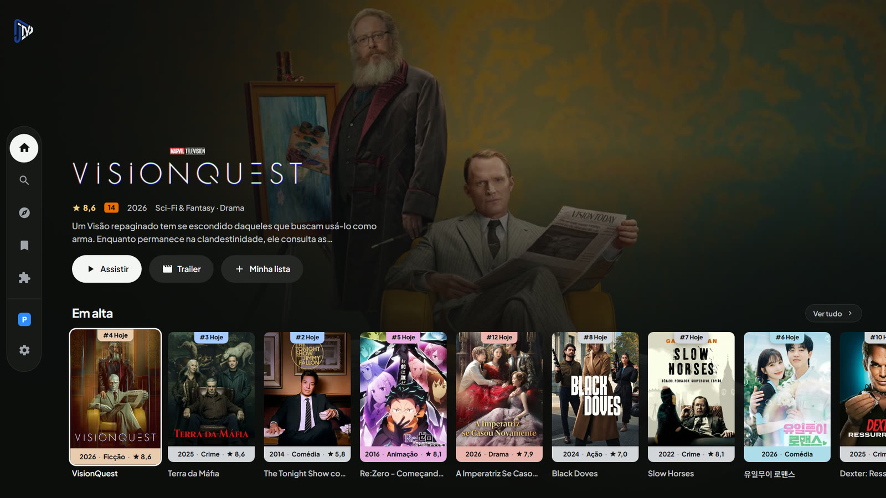<br><b>Início</b><br><sub>Destaque em tela cheia que acompanha o título em foco, com trailer opcional.</sub></td>
    <td width="50%">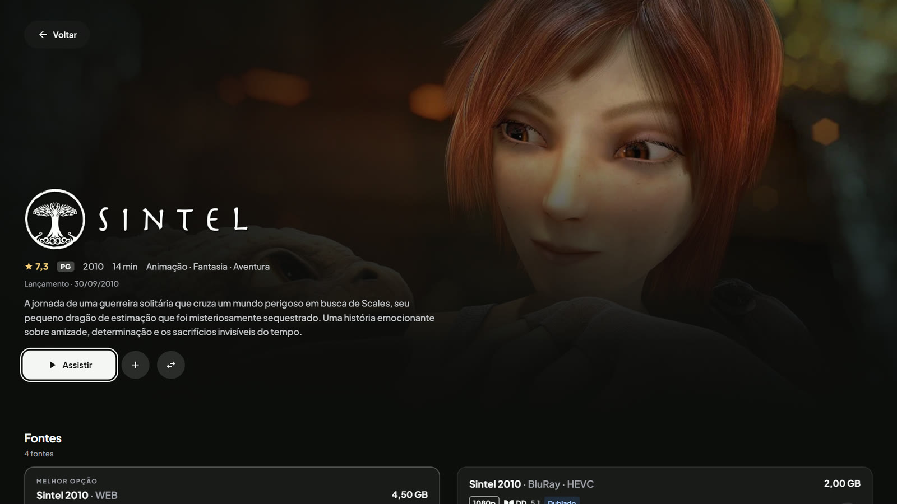<br><b>Detalhe</b><br><sub>Logo do título, nota, classificação, sinopse e o Assistir que já sabe a melhor fonte.</sub></td>
  </tr>
  <tr>
    <td width="50%">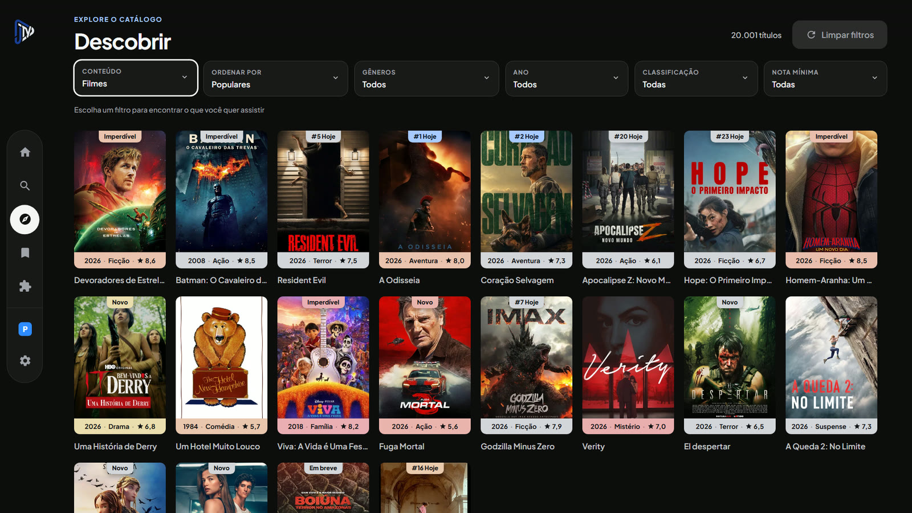<br><b>Descobrir</b><br><sub>Filtros de conteúdo, ordem, gênero, ano, classificação e nota mínima.</sub></td>
    <td width="50%">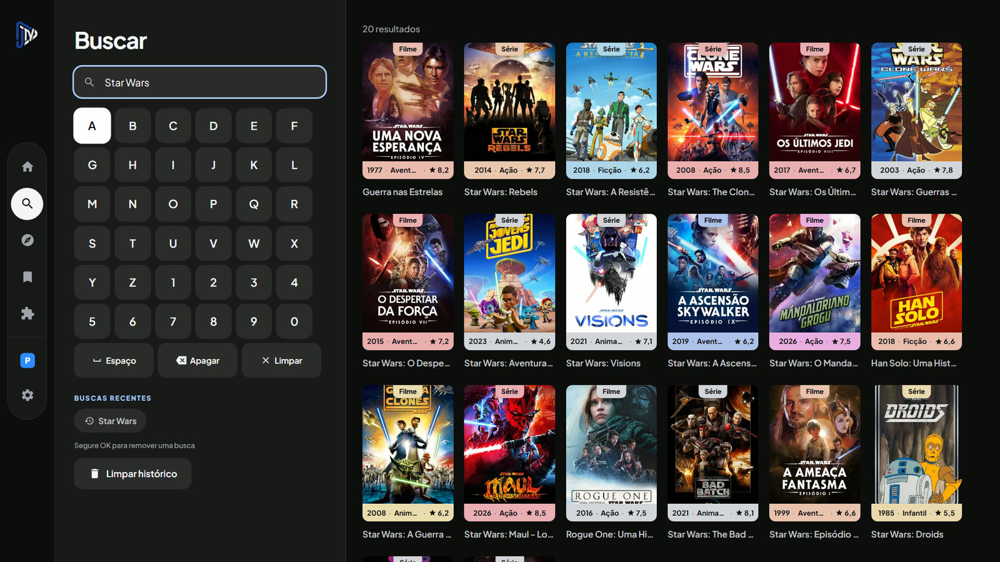<br><b>Busca</b><br><sub>Teclado na tela pensado para o controle e buscas recentes.</sub></td>
  </tr>
  <tr>
    <td width="50%">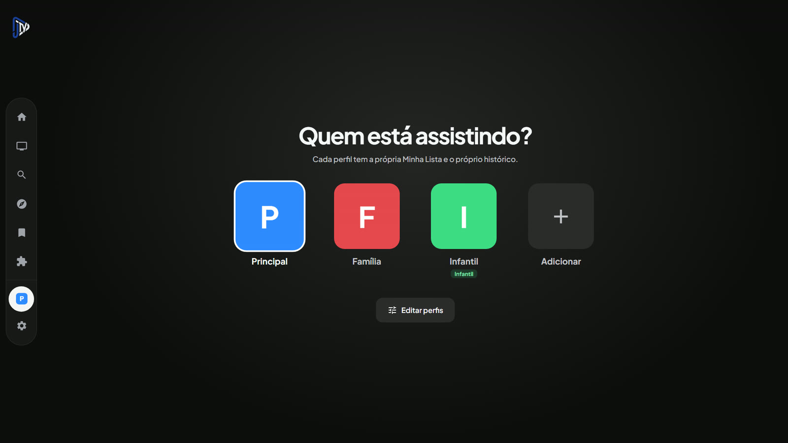<br><b>Perfis</b><br><sub>Cada perfil com a própria lista e o próprio histórico, e o perfil infantil.</sub></td>
    <td width="50%">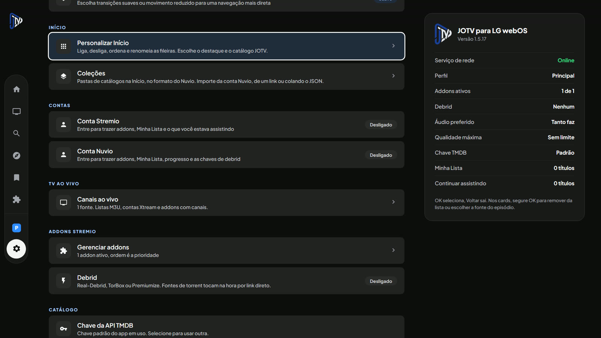<br><b>Configurações</b><br><sub>Início, Coleções, contas, TV ao vivo, addons e debrid, com o resumo ao lado.</sub></td>
  </tr>
</table>

## No celular

O mesmo visual da TV, feito para o toque, com a barra em cápsula embaixo. Tem tudo o que a TV tem e
mais o editor de coleções, downloads, Chromecast e Picture in Picture.

<p align="center">
  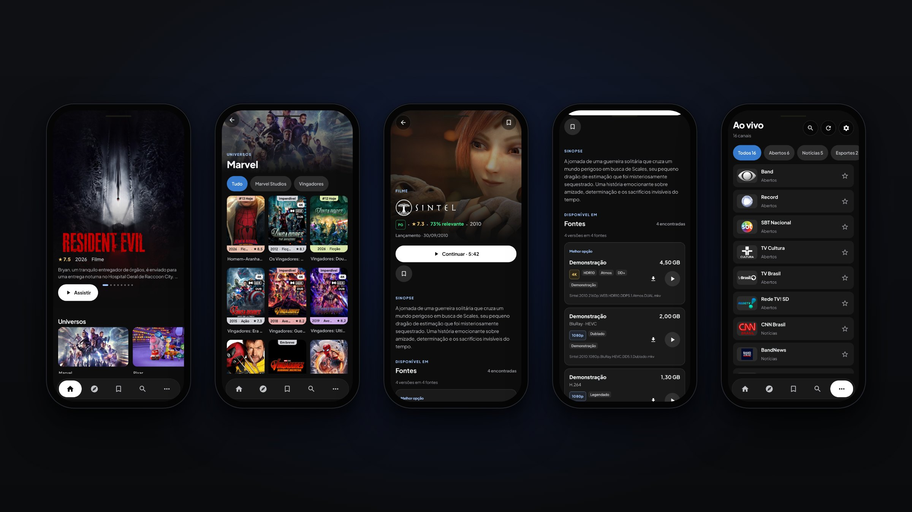<br>
  <sub>Início com a coleção fixada, pasta Marvel com a aba Tudo, detalhe, lista de fontes e TV ao vivo</sub>
</p>

## No Windows

O mesmo app da TV no computador, leve e em tela cheia, com o vídeo tocando no mpv e os controles do
player iguais aos da TV. Funciona com teclado (setas, Enter e Esc) e com mouse. Para sair da tela
cheia, aperte F11 ou leve o mouse ao topo da tela, que aparecem os botões de sair da tela cheia,
minimizar e fechar. Torrent toca sem debrid pelo motor P2P embutido, e os menus Lateral, Superior e
Oculto funcionam com o mouse.

## Tudo o que o app faz

<details open>
<summary><b>Catálogo e descoberta</b></summary>

- Início com destaque em tela cheia, trailer opcional que toca sem som depois de alguns segundos, Continuar assistindo e Novos episódios
- Fileiras de tendências, populares, nos cinemas, lançamentos do ano, trailers e gêneros, todas do TMDB
- Descobrir com filtros de conteúdo, ordem, gênero, ano, classificação e nota mínima
- Busca de filmes e séries com buscas recentes
- Detalhe com elenco, temporadas, episódios, recomendações e a franquia do filme
- Logo do título em português quando existe, notas com vírgula e classificação indicativa do Brasil

</details>

<details>
<summary><b>Fontes e player</b></summary>

- Escolha automática da melhor fonte pelo áudio preferido (dublado, legendado ou tanto faz) e pela qualidade máxima
- Teste rápido das fontes, com troca automática quando uma não responde
- Lista de fontes com selos de resolução, HDR, Dolby Vision, Atmos, DTS e idioma
- Som de outra fonte sincronizado, para assistir uma versão ouvindo o áudio dublado de outra
- Pula a abertura que você já pulou uma vez e passa para o próximo episódio sozinho
- Legenda com tamanho, fundo e atraso ajustáveis, em 53 idiomas
- Player do celular com os controles na base, como na TV, e botões grandes para o toque
- Prévia em miniatura ao arrastar a barra (celular)
- Chromecast, Picture in Picture e controle pela tela bloqueada ou pelo fone (celular)
- Download para assistir sem internet (celular)
- DNS seguro da Cloudflare nos links de vídeo, para fugir de bloqueio de operadora (celular)

</details>

<details>
<summary><b>Addons</b></summary>

- Gerenciador com ordem de prioridade, liga e desliga
- Loja com o catálogo da comunidade
- Configuração no site do addon, com QR code para configurar pelo celular e levar o link pronto para a TV
- Catálogos dos addons viram fileiras da Início, com o painel Fileiras para escolher quais aparecem (um addon novo entra com 10)
- Você decide quais addons usar. O app começa sem nenhum, no celular e na TV, e você instala pelo link do manifest, pela Loja ou trazendo da sua conta Stremio ou Nuvio

</details>

<details>
<summary><b>Plugins</b></summary>

- Gerenciador em Configurações, Plugins (perfil adulto), que começa vazio e só instala o que você colar
- Repositório JavaScript no formato do Nuvio, arquivo JavaScript individual ou addon Stremio
- Provedor novo começa desligado, com ativação, configurações próprias e teste de fontes
- Busca, filtros, ordem de prioridade, atualização com conferência diária, backup e limpeza do cache
- As fontes entram na lista de fontes e no player, com os cabeçalhos HTTP e as legendas
- Busca em paralelo (até 32 ao mesmo tempo), com cada fonte aparecendo assim que chega, e cache curto
- Código isolado no QuickJS, com limites de memória, tempo, rede e dados

</details>

<details>
<summary><b>Coleções</b></summary>

- Fontes de addon e do TMDB (lista, franquia, estúdio, canal, descoberta com filtros, ator e direção)
- Pasta com abas e aba Tudo, ou uma fileira por fonte
- Capa, emoji, GIF animado e formato pôster, paisagem ou quadrado
- Coleção fixada no topo da Início
- Editor completo no celular, com atalhos para estúdios e canais conhecidos e busca no TMDB
- Importa o mesmo JSON do Nuvio pela conta Nuvio, por link ou colando o texto, e exporta pelo celular

</details>

<details>
<summary><b>Contas, debrid e torrent</b></summary>

- Stremio e Nuvio por e-mail ou QR, importando addons, Minha Lista, progresso e as chaves de debrid salvas na conta
- Real-Debrid (por código ou chave), TorBox e Premiumize
- Motor P2P no Android, no Windows e na LG webOS recente, com o vídeo tocando enquanto baixa
- Na Samsung o P2P é experimental e vem desligado, e sem ele o torrent toca pelo debrid
- Trazer tudo e painel O que veio mostram o resultado de cada parte importada, com o registro por perfil

</details>

<details>
<summary><b>TV ao vivo</b></summary>

- Listas M3U, contas Xtream e addons com canais
- Guia XMLTV (inclusive compactado em .gz no celular e na LG)
- Categorias, favoritos, recentes e busca de canal
- Guia de canais dentro do player, com a lista e a programação por cima do vídeo, e troca de canal pelo CH+ e CH-, com o programa atual na tela
- Na Android TV, filtros por favoritos, recentes, fonte e grupo, busca por canal ou programa, troca pelo número do canal e o 0 para voltar ao anterior
- Addons com canais ao vivo entram como fonte, com o nome Addon ao vivo
- A aba Ao vivo só aparece depois que você cadastra uma fonte

</details>

<details>
<summary><b>Perfis e família</b></summary>

- Vários perfis, cada um com Minha Lista, histórico, progresso e preferências
- Perfil infantil que só mostra animação e família e bloqueia título acima de 12 anos
- PIN dos pais para sair do infantil e mexer em perfis e ajustes
- TV ao vivo, catálogos de addon e coleções ficam fora do perfil infantil

</details>

<details>
<summary><b>Feito para cada tela</b></summary>

- Celular, tablet e Android TV no mesmo APK, com layout próprio para o controle remoto na TV
- LG webOS e Samsung Tizen em app próprio, leve e sem framework
- Windows 10 e 11 em app próprio, com a interface da TV e o player mpv
- Navegação inteira pelo controle, com foco sempre visível e retorno ao card de onde você saiu
- Temas Grafite, Azul e Verde e opção de movimento reduzido (TV)
- Menus Lateral, Superior e Oculto por perfil, na TV e no computador
- Tamanho da interface (Padrão, Médio e Grande) por perfil na Android TV
- Medidor de quadros em Configurações, Diagnóstico, para medir o desempenho no próprio aparelho (Android)

</details>

## Instalação

Todos os arquivos ficam na página de **[Releases](../../releases/latest)**. Não precisa compilar nada.

| Aparelho | Arquivo | Precisa de |
|---|---|---|
| Celular ou tablet Android | `JOTV-v*.apk` | Android 6 ou mais novo |
| Android TV e Google TV | `JOTV-v*.apk` | Android TV 6 ou mais novo |
| TV LG | `JOTV-webOS-v*.ipk` | webOS 4 ou mais novo, em modo desenvolvedor |
| TV Samsung | `JOTV-Tizen-v*.wgt` | Tizen 5.5 ou mais novo (TVs de 2020 em diante), em modo desenvolvedor |
| Computador | `JOTV-Windows-v*-setup.exe` | Windows 10 ou 11 de 64 bits |

<details>
<summary><b>Celular ou tablet Android</b></summary>

1. Baixe o `.apk` da Release direto no aparelho.
2. Abra o arquivo. Na primeira vez o Android pede para liberar a instalação de fonte desconhecida no app que você usou para baixar (navegador ou Arquivos). Libere e confirme.

O APK é para aparelhos ARM, que são quase todos os celulares, tablets e TV boxes. Emulador de computador (MuMu, MEmu, BlueStacks) roda pela tradução do próprio emulador.

</details>

<details>
<summary><b>Android TV e Google TV (qualquer marca)</b></summary>

Vale para Sony, TCL, Philips, Hisense, Xiaomi, NVIDIA Shield, Chromecast com Google TV, Fire TV e
qualquer aparelho com Android TV. A instalação é por sideload, de um destes jeitos.

**Pelo computador, com ADB.** Na TV, libere as opções do desenvolvedor (em geral tocando várias vezes
na versão do sistema em Configurações, Sobre) e ligue a depuração de rede. No PC, com o
[Android Platform Tools](https://developer.android.com/tools/releases/platform-tools) instalado,

```sh
adb connect <ip-da-tv>:5555
adb install JOTV-v<versão>.apk
```

**Direto na TV.** Instale um app como o Downloader ou o Send Files to TV pela loja da própria TV,
baixe o `.apk` por ele e instale.

</details>

<details>
<summary><b>TV LG (webOS)</b></summary>

1. Na TV, instale o app **Developer Mode** pela LG Content Store, entre com uma conta grátis de [developer.lge.com](https://developer.lge.com) e ligue o modo desenvolvedor e o Key Server. Anote o IP e a frase (passphrase) que aparecem na tela.
2. No computador, instale a [CLI do webOS TV](https://webostv.developer.lge.com/develop/tools/cli-installation) (precisa do Node.js) e cadastre a TV uma vez.
   ```sh
   npm install -g @webos-tools/cli
   ares-setup-device
   ```
3. Instale e abra o app.
   ```sh
   ares-install --device <nome-da-tv> JOTV-webOS-v<versão>.ipk
   ares-launch --device <nome-da-tv> com.joabtv.app
   ```

O modo desenvolvedor desliga sozinho depois de alguns dias. Se o app sumir, abra o Developer Mode e
renove a sessão (o IP e a frase podem mudar).

</details>

<details>
<summary><b>TV Samsung (Tizen)</b></summary>

1. Na TV, abra a área de Apps, digite **1 2 3 4 5** no controle e ligue o modo desenvolvedor com o IP do seu computador. Reinicie a TV.
2. No computador, instale o [Tizen Studio](https://samsungtizenos.com/tools-download/) (o instalador de linha de comando basta). Ele traz o `sdb`.
3. Conecte e instale.
   ```sh
   sdb connect <ip-da-tv>:26101
   sdb install JOTV-Tizen-v<versão>.wgt
   ```

O `.wgt` sai assinado com certificado de desenvolvedor, o que basta para uso pessoal em modo
desenvolvedor. Ele não serve para a loja da Samsung.

</details>

<details>
<summary><b>Windows</b></summary>

1. Baixe o `JOTV-Windows-v<versão>-setup.exe` da Release e abra.
2. O instalador não tem assinatura digital paga, então o Windows pode avisar que protegeu o computador. Clique em **Mais informações** e depois em **Executar assim mesmo**.
3. O JOTV abre em tela cheia. F11 ou Alt+Enter alternam a tela cheia, e o mouse no topo da tela mostra os botões de sair da tela cheia, minimizar e fechar.

</details>

<details>
<summary><b>Roku, Apple TV ou outra TV sem Android, webOS ou Tizen</b></summary>

Essas não têm versão própria. Ligue um aparelho com Android TV na entrada HDMI (um Chromecast com
Google TV, um TV Box Android ou um Fire TV Stick) e instale o APK nele. A TV vira só a tela.

</details>

## Para desenvolvedores

Este repositório traz o código do app Android (celular, tablet e Android TV). As versões de LG,
Samsung e Windows saem como pacote pronto nas Releases.

<details>
<summary><b>Como o app é feito</b></summary>

```
UI (Jetpack Compose)  →  ViewModel (Hilt)  →  Repository  →  Room / Retrofit (TMDB) / addons Stremio (OkHttp)
```

- Jetpack Compose com Material 3 e `androidx.tv` para a TV. Uma árvore só de telas se adapta ao celular, ao tablet e à TV.
- Hilt para injeção de dependência e Room para perfis, Minha Lista, histórico, episódios vistos e downloads.
- Preferências por perfil em `PlatformPrefs`, inclusive a Início personalizada e as coleções.
- Media3 (ExoPlayer) com `MediaSession` e Chromecast, e libtorrent4j no motor P2P.
- Retrofit e OkHttp para o TMDB, com DNS seguro para os links de vídeo dos addons.
- O motor de plugins roda num WebView interno com Workers e QuickJS, sem acesso ao app. O código fica em `data/plugins` e as bibliotecas em `assets/plugins`.

</details>

<details>
<summary><b>Como compilar</b></summary>

Precisa do **JDK 17** (ou do JBR do Android Studio) e do Android SDK. Crie um `local.properties` na
raiz, que não entra no Git,

```properties
sdk.dir=/caminho/para/o/Android/Sdk
```

A chave do TMDB pode ir no `~/.gradle/gradle.properties` como `TMDB_API_KEY`. Depois,

```sh
./gradlew installDebug          # instala num aparelho conectado
./gradlew assembleRelease       # APK de release em app/build/outputs/apk/release/
./gradlew testDebugUnitTest     # testes
```

O APK de release leva só ARM. Para testar num emulador x86, use o `installDebug`, que leva também as
bibliotecas x86.

Sem a `TMDB_API_KEY` o app abre pedindo a sua chave do TMDB em Configurações. O APK das Releases já
vem com uma chave pronta. A sincronia com o
Trakt liga quando `TRAKT_CLIENT_ID` e `TRAKT_CLIENT_SECRET` estão no `local.properties`. Chave do
TMDB em [themoviedb.org/settings/api](https://www.themoviedb.org/settings/api) e app do Trakt em
[trakt.tv/oauth/applications](https://trakt.tv/oauth/applications).

</details>

<details>
<summary><b>Estrutura do projeto</b></summary>

```
app/src/main/java/com/joabtv/app/
├── data/
│   ├── accounts/      contas Stremio e Nuvio e o registro de importação
│   ├── collections/   coleções no formato do Nuvio
│   ├── debrid/        Real-Debrid, TorBox e Premiumize
│   ├── live/          M3U, Xtream e guia XMLTV
│   ├── local/         Room e preferências por perfil
│   ├── plugins/       gerenciador e motor de plugins
│   ├── remote/        TMDB, addons Stremio, legendas e DNS seguro
│   ├── repository/    biblioteca e downloads
│   └── torrent/       motor P2P
├── di/                módulos Hilt
├── domain/model/      filme, série, episódio e elenco
└── ui/
    ├── collections/   coleções, pasta e editor
    ├── common/        componentes e layout adaptável
    ├── live/          TV ao vivo
    ├── movies/        Início, detalhe, busca e player
    ├── navigation/    navegação e menus da TV (lateral, superior e oculto)
    ├── settings/      Seu catálogo, Minha Início, addons, plugins, contas, debrid e perfis
    ├── theme/         cores e tipografia
    └── tv/            telas exclusivas da TV
```

</details>

## Aviso legal

O JOTV não hospeda, não distribui e não guarda vídeo nenhum. Ele é um player e uma interface para
addons de terceiros no protocolo Stremio e para plugins de terceiros, que a própria pessoa escolhe
instalar. O JOTV não traz nem recomenda nenhum plugin. O uso e a legalidade das fontes acessadas por
esses addons e plugins são responsabilidade de quem os instala.

Este produto usa a API do TMDB, mas não é endossado nem certificado pelo TMDB. As capturas usam
dados públicos do TMDB, canais abertos e o filme aberto Sintel, da Blender Foundation (CC BY 3.0),
numa fonte de demonstração.

## Licença

[Apache License 2.0](LICENSE)

O instalador de Windows leva o [mpv](https://mpv.io) como programa separado, que é software livre
sob a GPL. O código do mpv fica em [mpv-player/mpv](https://github.com/mpv-player/mpv) e a build
usada vem de [zhongfly/mpv-winbuild](https://github.com/zhongfly/mpv-winbuild/releases/tag/2026-10-26-baa3e11d42).

O motor de plugins leva o QuickJS e bibliotecas JavaScript de código aberto. As licenças ficam em
`app/src/main/assets/plugins/LICENSES.txt`.
